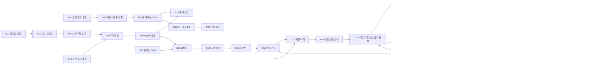

# ISOEdu 참고자료 기반 작성·구현 기준

## 공개 첫 화면 디자인 개편 (2026-11-12)

사용자 지정 참고 https://sike.kr/ 의 여백·명조체·사진 중심 구성을 어니스톤 공개 홈에 적용했다. 밝은 종이색, 절제된 메뉴, 큰 제목과 영문 워드마크, 기존 `public/instructors/cho-youngbin.png` 대표 사진·이름으로 구성한다. 참고 사이트의 문구·상품 이미지·로고는 사용하지 않는다. 사진 원본은 변경하지 않고 표시 영역만 조정한다.

관련 S02·S03·S05·S11~S17. 공개 홈 → 기존 준비 분야/회사 입력 → 로그인·회사 확인 → 준비 업무/문서 흐름을 유지한다. interest/companyName/industry/employees/region 및 기존 draft.id·ownerId의 전달·임시 보관·권한 계약을 변경하지 않는다. 공식 심사·발급이나 AI 생성 성공을 보장하는 표현을 추가하지 않는다. UX-001 업무 사이드바·회사/문서/필터 상태는 기존 셸을 유지한다.

검증: 운영 빌드 성공, 기존 준비 입력·공개 공고 테스트8개 통과. 운영 빌드 브라우저에서 1470px/390px 레이아웃·대표 사진 로딩·가로 넘침 없음, 시작 버튼의 기존 입력 영역 이동, 지원사업 캘린더 연결, 로그인 계정의 내 업무 링크 표시 확인. 운영 계정 문서 저장·AI 호출은 이번 디자인 검증에 포함하지 않았다. feature-registry의 publicMasthead20261112 및 장표 연결표와 동기화.

검토일: 2026-10-14. 기준 원본은 `참고자료`의 「조영빈Iso 플랫폼 2차_20261012.pptx」(36장)와 「어니스톤 사업계획서 서티멘토서티루트 마스터본초안 20261010 v5.pdf」(18쪽)이다. 실제 파일명은 [기능 레지스트리](feature-registry.json)의 sources를 따른다.

## 자료의 역할

사업계획서 1~2·6~8쪽을 고객, 상품, 운영 범위의 기준으로 사용한다. PPTX는 화면 구조와 세부 기능의 기준이다. 기존 `functional_specification.md`와 `FUNCTIONAL_SPEC_SHEET.md`는 이전 명세로 유지하되, 충돌은 이 문서에 기록하고 최신 자료를 우선 적용한다. 사업계획서의 가격은 안, 매출·파트너 수익은 추정, 확인 필요 항목은 미확인으로 보존한다. 법령·표준 개정 날짜는 자료 속 주장으로만 취급하며 실제 서비스 정책에 적용할 때 공식 자료로 재확인한다.

## 사업 흐름과 기능 연결

화살표는 제안된 데이터·업무 인계이며, 모든 화면을 차례로 클릭해야 한다는 뜻이 아니다. 개별 장표의 선행 관계는 [장표 연결표](slide-feature-map.md)와 [레지스트리](feature-registry.json)에서 관리한다. S05는 기업 요약, S31은 운영 요약으로 각 기능의 저장된 결과를 집계한다.

## 연결을 보존할 데이터 계약

| 경계 | 다음 기능으로 전달할 데이터 | 확인 조건 |
| --- | --- | --- |
| 계정 → 모든 기능 | 사용자, 회사, 회사별 역할, 프로젝트 접근 범위 | 서버에서 회사·역할 검사; 가입 유형만으로 특권 부여 금지 |
| 기업 → 진단 | 회사·사업장, 업종, 규모, 인증 종류·판본·범위 | 사업장과 심사 범위를 구별 |
| 진단 → 문서 | 진단 ID, 조항 ID, 미충족 항목, 기준 버전 | 준비율 계산의 분모·미답변 처리 명시 |
| 문서 → 신청 | 문서 ID, 검토 상태, 고정된 버전·증적, 신청자 | 제출 당시 버전을 보존; 편집 후 제출본 변조 방지 |
| 문의 → 파트너 | 문의 ID, 동의, 전문분야, 배분 규칙 버전, 담당자 | 배분 근거·수락·거절·재배분 이력 |
| 신청 → 심사 | 신청 ID, 인증기관, 견적, 결제 상태, 심사원, 이해상충 검토 | 기업 직접 제출과 플랫폼 내부 요청을 구별 |
| 심사 → 사후관리 | 결과 ID, 발급기관, 인증서, 유효기간, 다음 심사일 | 공식 발급과 파일 업로드 구별; 날짜 누락은 미확인 |
| 결제 → 정산 | 주문 ID, 실제 결제액, 환불액, 계약·배분율 버전 | 정수 원 단위 또는 decimal 사용; 상태 변경은 서버 확정 |
| 일정 → 알림 | 회사·담당자, 동의·채널, 이벤트, 기준 시점 | 중복 방지·실패 재시도·발송 이력 |

## 디자인 분석과 적용

36개 장표의 삽입 화면 이미지를 추출해 [전체 디자인 비교 이미지](slide-design-contact-sheet.jpg)에서 검토했다. 원본 장표 자체는 제목·화면 이미지·기획 의도·기술 명세로 구성된다. 제목 24pt와 본문 회색(#333333/#555555)은 프레젠테이션 텍스트 값이며, 웹 디자인 토큰으로 그대로 옮기지 않는다.

화면 이미지의 반복 패턴은 밝은 회색 배경, 흰 작업 영역, 파란 주요 동작, 좌측 메뉴, 상단 회사·사용자·알림, 우측 도움말·상세 패널이다. 일부는 짙은 남색 메뉴이고 일부는 밝은 메뉴이므로 웹에서는 하나의 공통 셸로 통일하는 것을 제안한다. 인증 종류·회사·프로젝트 선택은 화면 이동 후에도 유지하고 URL이나 명시적인 컨텍스트로 연결한다.

| 패턴 | 관련 장표 | 구현 기준 |
| --- | --- | --- |
| 단계 입력 | 2·7·13·19 | 현재 단계·필수 필드·임시 저장·다음 행동 표시 |
| 목록과 상세 패널 | 10·12·17·21·32·33 | 선택 항목과 필터 보존; 좁은 화면은 상세 페이지나 시트 |
| KPI와 근거 목록 | 5·8·9·26·31·36 | 요약 클릭이 실제 필터된 근거 목록으로 연결 |
| 문서 작업 | 14·15·16·17 | 작성→검토→버전 확정 연결; AI 초안과 승인된 문서 구별 |
| 일정과 상태 | 22·23·28·29 | 추천·임시 예약·확정 구별; 서버 충돌 처리 |
| 알림과 설정 | 25·27·34 | 알림에서 대상 문서·인증·신청으로 이동 |

정확한 웹 폰트·간격·색상은 이미지 눈대중으로 확정하지 않는다. 실제 구현에서 토큰을 정의하고 대표 화면을 원본과 비교한다. 상태는 색상과 문자를 함께 사용하고, 주요 행동을 명확히 둔다. 모든 화면은 로딩·빈 상태·실패·권한 없음·저장 성공을 갖춘다.

## 원본 간 차이와 결정 기준

| 항목 | 자료 간 차이 | 작성 기준 |
| --- | --- | --- |
| 신청·발급 | PPT S19·S24는 신청·발급까지 기술; 사업계획서 6쪽은 기업 직접 신청 | 준비 자료·셀프 안내·기업 제출 기록을 기본으로. 공식 심사 접수·배정·발급은 인증기관 역할과 연동 범위 확정 후 구현 |
| 수입·취득 보장 | 기존 명세는 과태료·불이익 제로 보장과 대행 수수료 표현; 사업계획서 5~6쪽은 취득·일감 보장 및 성공보수 배제 | 제품 문구와 새 명세는 사업계획서 기준으로 작성 |
| 교육·파트너 | PPT에는 수강·수료·파트너 CRM 전체 흐름 부재 | B01~B06으로 별도 추적; 심사원 자격과 준비 컨설턴트 역할을 분리 |
| 상품·배분 | 사업계획서 6쪽 가격·70% 배분은 계획안 | 변경 가능한 상품·계약 버전으로 설계; 실제 확정 요율처럼 하드코딩하지 않음 |
| 외부 플랫폼 실적 | 사업계획서 7쪽의 서류다 v2.8 운영 언급 | ISOEdu에서 OCR·알림·결제가 구현됐다는 근거로 사용하지 않음 |
| 기술 스택 | PPT에 여러 상태관리·차트·API 예시 혼재 | 현재 Next.js·Supabase 구조를 우선 사용; 필요가 검증될 때 도입 |

## 구현 순서와 완료 기준

1. 계정·회사·역할과 인증 등록(S02~S04·S07)을 먼저 연결한다.
2. 자가진단·Gap·문서(S08~S17)를 하나의 회사·프로젝트 데이터로 연결한다.
3. 사후관리(S26~S29)와 셀프 안내(B04)를 연결한다. 자동 발송은 실제 발송 인프라 검증 후 표시한다.
4. 교육·파트너 검증·문의 배분(B01~B03)을 준비 상담(S10)에 연결한다.
5. 상품·결제·구독·정산(B05·S20·S35)을 확정된 계약으로 연결한다.
6. 기관 연동 심사 운영(S19·S21~S24·S33)과 운영 CMS·분석(S31~S36·B06)을 확장한다.

이는 개발 의존성 기준의 제안이며 사업계획서 8쪽의 2026~2027년 사업 일정과 구별한다. 현재 코드 후보 매핑은 정적 확인만 했으며 운영 완료 판정이 아니다.

각 작업은 관련 S/B ID, 원본 근거, 화면 변화, 입력·출력 데이터, 선행·후속 기능, 권한, 검증 결과를 기록한다. 레지스트리와 연결표를 함께 갱신한다. UI 버튼이나 목업만 있는 기능은 실제 연동 완료로 표시하지 않는다. 참고자료가 갱신되면 원본 날짜와 변경된 ID·연결·상품 정책을 먼저 기록한다.

## 공통 디자인 1차 적용 기록 (2026-10-14)

공통 토큰·Button 컴포넌트·ISOEdu 헤더·인증 관리 탐색을 구현했다. 관련 기능은 S02·S05·S08·S11·S19·S26이다. 로그인·문서 등록·배너 주요 동작에 공통 버튼을 적용했다. 기존 회사 컨텍스트와 저장·권한 경로를 사용하며 탐색만으로 데이터를 수정하지 않는다. `npm run build` 성공, `npm test` 30개 통과. 실제 브라우저 시각 검증 및 모든 화면의 입력·표 컴포넌트 통합은 남아 있다. 이 기록은 개별 업무 기능의 완료를 의미하지 않는다.

## 개발 스타일 로딩 복구 (2026-10-17)

개발 서버와 프로덕션 빌드가 `.next`를 함께 사용하면 실행 중인 페이지의 CSS 경로와 생성 파일이 불일치할 수 있다. `next.config.mjs`에서 개발 출력은 `.next-dev`, 빌드는 `.next`로 분리했다. `.next-dev`는 Git 제외 대상으로 추가했다. localhost:3000 새로고침 후 남색 메뉴·도넛·카드 스타일 렌더링을 확인했다. 업무 데이터·권한 변경 없음.

## 플랫폼 브랜드

사용자 확정 명칭은 **어니스톤**이다. 로고·페이지 제목·로그인·도움말의 플랫폼 표기를 통일한다. ISO는 인증 분야 명칭으로 사용한다. 기존 isoedu 저장소·로컬 저장 키·기업 자료 원문은 유지한다.

어니스톤 파비콘: `src/app/icon.svg`. 남색 바탕·파란 돌 형태·흰색 H로 구성하며 Next.js 아이콘 메타데이터로 제공한다.

## 고객 작성사례의 서비스 연결

2026-10-18: /documents/references에서 작성사례123개·65묶음 목록/고객/형식 검색 및 뷰어 연결. PDF는 Range 지원 원본 뷰어, HWP/HWPX/DOC/DOCX/PPT/PPTX는 전 구간 추출 본문과 원본 다운로드 제공. 각 문서 원문 목차 후보 또는 유형별 제안 구성은 사용자 검토 후 대상 회사·사업 아이템에 적용한다. 타 회사 원문 수치/실적 복사 없이 목차별 입력 초안을 미리보고 기존 문서 저장소에 DRAFT로 저장한다. companyId, businessItem, referenceOrigin(id/sha256/revision/headings/확인상태)을 S03→S12/S13→S14/S15→S17에 인계. 파일은 localhost 개발서버에만 제공하며 운영환경 API403, 현재회사 문서 저장은 기존 인증/RLS 경로 사용. 로컬 저장소 재조회·회사 격리·클라우드 필드 변환 테스트 검증. 실제 로그인한 회사의 클라우드 저장은 미검증. AI 본문 완성 및 원본 편집형식 내보내기는 미구현.

## 거래처별 실제 문서 관리

2026-10-18 사용자 정정 반영: 참고문서 라이브러리를 문서 관리 기본 화면에서 제외하고 /documents 거래처 드라이브로 대체. 원본 라벨 기준65개 거래처 폴더에 기존123개 문서를 연결했다. /documents/iso는 기존 ISO 규격 문서, /documents/references?reference=...는 기존 링크 호환용 거래처 파일 뷰어 진입. 거래처/하위 폴더 생성, 파일 업로드(50MB), 이름 변경, 폴더 이동, 휴지통/복원, 원본 다운로드·PDF/이미지/추출 본문 뷰어, TXT/MD 편집과 이전 바이트 보관 구현. 다른 거래처 문서 작성은 대상 폴더의 거래처ID·이름과 사업 아이템을 사용해 목차 기준 MD 초안을 실제 파일로 생성하고 referenceOrigin/작성 상태를 보관한다. S03 거래처→S11 파일→S12 기준→S13 입력→S14/S15 작성/편집→S17 근거·이력 인계. 현재 데이터는 data/client-drive/state.json 및 로컬 파일에 저장하며 로컬 단일 사용자 범위다. Supabase 회사/사용자 권한·공유/동기화와 연동 완료한 것으로 표시하지 않는다. 법인 관계나 현재 계약 여부는 원본 폴더명만으로 확정하지 않는다.

50개 테스트 통과 및 빌드 성공. 직렬화된 저장·재시작 재조회·동시 변경 보존·폴더 순환/중복 차단·원본 보호·휴지통 접근404·복원·대상거래처 초안 생성·텍스트 편집 이전본 보존 검증. 실제 로컬API에서도 업로드/이름변경/이동/편집/다운로드/휴지통/복원/초안 생성 확인. 임시 항목 정리 후65폴더123파일 유지. 외부 클라우드 저장·공유·전체Office 원본배치 뷰어는 미구현.

## 최근 회의의 우선순위 (2026-10-29 사용자 지시)

[2026-10-23 회의 반영 명세](meeting-2026-10-23.md)를 최신 업무 우선순위로 적용한다. CRM 이관, 회사별 공동 컨설턴트, 고객 서류 제출, 실제 기관 양식 작성, 심사·만기 관리 순이다. 기존 개발 의존성·기업 직접 신청과 공식 기관 역할 구분은 유지한다. 관련 B03·S02·S03·S11~S13·S15·S17·S20·S23·S24·S26·S27·S33의 인계와 검증 상태를 레지스트리·연결표에 함께 기록했다. 코드·로컬 DB 검증과 실제 운영 적용을 구분한다.

## 유형별 원본 유효기간과 최신본 재요청 (2026-10-29)

S03 → S13 → S11 → S17 → S26/S27·S33: 노션 유형별 기준을 버전 보관하며 신청일·설립일·원본 발급일/유효일·자료 연도·기간 확인과 회사/프로젝트/문서 ID 및 원본 경로/해시를 인계한다. 2주·달력 1개월·명시 만료·3개년을 구분하고 기준 없는 기간은 추측하지 않는다. 보유본 우선 수령 후 신청 창구에 맞춰 갱신 요청하며, 만료 제출본은 내부 보완 요청/업무로 전환한다. 동일 원본 반복 요청 방지, 새 파일 날짜 초기화, 접수 후 중지, 회사 권한·동시 저장 검증. 115개 테스트와 빌드 통과. 운영 DB 59개 규칙 적용·대표 권한 임시 생성/저장 후 롤백 검증 완료. 회사69·문서130 보존. pg_cron GMT 00:00(한국09:00) 예약 활성·최초 실행 오류0/활성프로젝트0. 프로젝트별 유형 기준 저장 후 자동 검사 대상이 된다. 외부 메시지는 발송하지 않는다.

## 업로드 원본의 날짜 후보 자동 읽기 (2026-10-29)

S11 → S16 자동 읽기 → S13 담당자 확인 → S17 날짜 저장 → S26/S27 재검사。고객 제출·심사 운영에서 업로드/보관 문서 제출 직후 PDF·스캔 이미지·HWP/HWPX·DOCX·XLSX의 날짜/자료 연도 후보를 브라우저에서 읽는다. 자체 제공 OCR, 외부 AI 전송 없음. 근거 위치·문구와 후보를 대조 확인한 후 기존 날짜 저장 RPC로 확정. 경로/revision 변경 시 폐기, 회사 전환 중단, 실패해도 원본 보존. 후보는 임시 화면 상태이며 다시 읽기 가능.

50MB·PDF 앞60쪽. HWP/Office 삽입 이미지/도형·비표준 Excel 서식 미확인 경고. 구형 DOC/XLS 자동 판독 미지원. 일반 드라이브 전체 업로드 소급 분석은 별도 범위. 121개 테스트·빌드 통과. 브라우저 합성 한국어 스캔/스캔PDF/HWP/HWPX/DOCX/XLSX 및 Excel 날짜일련번호 판독. 확인 전 저장 차단·값 수정 후 재확인 검증. 기존 DB 권한/저장 함수 사용, 스키마 변경 없음.

## 기존 거래처 문서 날짜 확인함 (2026-10-29)

S11 기존 거래처 문서 → S16 본문/OCR 후보 → S13 원문 대조 확인 → S17 날짜 사실·확인 이력。거래처 드라이브의 전체/회사별 날짜 확인 목록. 원본 해시를 대조하고 기존 추출 본문을 우선 활용, 없는 자료는 본문/OCR. 확인 대기/후보 없음/실패/완료 저장, 실패 재시도·이어 처리·중지. 회사 편집 권한과 원본 경로/행 변경 시점 확인. 원본 변경 시 기존 후보 무효화. 일반 문서 편집에서 후보 유실·위조 차단.

documents.metadata.dateReading은 미확정 후보/근거, dateFacts는 담당자 확인값. 공식 인증 expiry_date·심사/프로젝트 유효기간 상태를 자동 변경하지 않음. 기존 내부 요청의 날짜 인계는 별도 승인 흐름을 유지. 127개 테스트와 빌드 통과. 운영 저장 RPC·보호 트리거 적용, 대표 계정 접근 가능 기존 문서의 실제 일괄 분석 진행. 사용자 확인/외부 발송은 수행하지 않음.

운영 실제 실행 결과: 대표 계정126건(후보26·후보없음100·실패0·사용자확인0). 원본 미이관3건은 저장본문 후보와 원본 미확인 경고로 구분, 50MB 초과 원본 저장 문제는 미해결. 확인 목록20건씩 페이지·근거 펼칠 때만 표시, 후보/없음/원본미확인 필터와 /documents?dateReview=1 직접 진입. 원본/본문/인증 만료일 유지. 공동컨설턴트 관계 추가로 생긴 PostgREST 프로필 관계 모호성은 소속회사 FK 명시로 수정·실제 로그인 재조회 검증. 전체128개 테스트·빌드 검증.

## 문서 날짜 검토 화면 정리 (2026-10-29)

S11·S13·S16·S17: 기존 문서 목록을 날짜 후보·자료 연도·상태의 한 줄 표로 표시한다. 문서를 선택하면 전체 화면 원문과 우측 날짜 검토 양식을 함께 제공한다. 검색·상태 필터·페이지 이동, 이전/다음 문서 및 확인 저장 후 다음 이동을 제공한다. 참고사항·근거는 접어서 표시하며, 검토 전용 진입에서는 상단 제목·탭·도구 여백을 줄인다. 문서 ID와 updated_at별 임시 입력을 닫기·이동 후 유지하고 회사 전환 시 초기화한다. 기존 회사 권한·원본 경로/버전·확인 RPC와 S16→S13→S17 전달을 유지한다. 실제 날짜 확정값·인증 만료일을 자동 변경하지 않는다. 로컬 목록·검토 패널·이전/다음·임시 입력·Esc를 확인했으며 실제 문서 확인 저장은 하지 않았다. PDF는 브라우저의 열기 설정에 따라 추가 열기가 필요할 수 있다.

## PDF 원문 즉시 표시 (2026-10-29)

S11·S16·S17: 공통 CloudFileViewer에서 PDF 원본 및 DOCX/HWP 등의 PDF 변환 미리보기를 브라우저 PDF 플러그인 대신 PDF.js 캔버스로 직접 표시한다. 문서를 선택하면 첫 페이지를 즉시 불러오고, 인접 페이지는 스크롤 시 렌더링하며 폭에 맞춘다. 기존 인증된 파일 URL·원본 다운로드·추출 본문·S13 날짜 검토를 유지한다. 로컬 실제 DOCX 변환 PDF가 별도 열기 없이 표시됨을 시각 확인했다. 앞선 검토 UI 문단의 브라우저 PDF 열기 설정 제한은 이 직접 렌더링으로 해소한다.

## PDF 읽기 도구 (2026-10-29)

S11·S16·S17: PDF 원본/변환 미리보기 공통 도구줄에 확대·축소(25~300%)·너비 맞춤, 페이지 번호 입력 및 이전/다음 페이지 이동, 원문 TextLayer 드래그 선택·복사, 문서 전체 검색(Cmd/Ctrl+F)·결과 수·이전/다음 결과·본문 강조를 제공한다. 검색은 문서 메모리에서 처리하고 파일·권한·S13 날짜 후보·S17 확인 저장을 변경하지 않는다. 스캔 등 텍스트가 없는 페이지는 OCR 필요 안내를 제공하며 OCR 자동 수행은 포함하지 않는다. 검색어 변경/종료 시 오래된 검색 작업을 취소하고 인접 페이지만 렌더링한다. 로컬 실제 9쪽 DOCX 변환 PDF에서 3쪽 이동·198% 확대·본문 범위선택·검색10건·마지막 결과9쪽 이동을 확인했다. 검색 분절/공백·호환 문자·강조 원문 보존 테스트 포함131건 통과.

## 스캔 PDF 자동 OCR (2026-10-29)

S11·S16·S17: 텍스트가 없거나 글자가 적은 이미지 페이지를 한국어·영어 OCR로 자동 읽고, 좌표 기반 선택 레이어와 문서 검색 결과에 통합한다. 전체 페이지를 자동 순회하며 한 문서의 OCR은 순차 처리한다. 완료 페이지부터 선택·복사·검색·강조를 제공하고, 진행·빈 페이지·실패·재시도를 구별한다. 페이지 제한을 두고 전체 완료로 표현하지 않으며, 실패는 명시한다. 모델·worker는 자체 제공하며 문서 픽셀은 브라우저에서 처리한다. 문서를 닫으면 worker·렌더링·인식을 중지하며 결과는 현재 열람 세션에만 캐시한다. 기존 원본·metadata·회사 권한·S13 날짜 후보/확정값·S17 저장은 변경하지 않는다. OCR 오인식 가능성을 표시하며 앞선 PDF 도구의 스캔 선택/검색 제한을 이 자동OCR로 보완한다. 텍스트가 전혀 없는 한/영 2쪽 시험PDF에서 OCR·검색(Alpha2건/사업계획서1건)·결과 페이지 이동·좌표 강조·드래그 선택을 시각 확인했다. 테스트135건 통과, 시험 route와 파일은 제거한다.

## 기업회원 즉시 사용 화면 (2026-10-29)

S01·S02·S03·S05·S11·S13·S16·S17: 신규 기업은 별도 가입 승인 없이 기존 가입 트리거로 생성되는 자기 회사 공간에 바로 진입한다. 기업 화면은 ‘우리 회사 준비/진행 현황/회사 문서함/회사·계정’으로 구성하고 처음에는 보유 서류 저장을 안내한다. 컨설턴트 거래처 관리·내부 운영 설정과 분리하되 공식 인증 심사/발급 역할을 부여하지 않는다. my_company_connections 조회 함수는 활성 본인의 can_read_company 회사와 can_edit_company 결과만 반환하고 UI 구분은 실제 관리 연결/공동 담당·관리자 역할에 따른다. 가입 metadata나 회사명 일치로 기존 거래처에 자동 연결하지 않는다. 기존 회사 가입 요청/권한 회수는 기존 계약대로 유지한다. 회사·계정별 화면 상태 격리와 사이드바 접기/펼치기(UX-001)를 유지한다. 회사 원본 업로드는 문서 생성→원본/버전 저장→문서 연결을 수행하며 동일 내용 재시도 시 버전을 재사용하고 계정/회사 전환 시 후속 쓰기를 중단한다. S13 제출·S17 저장에 회사/프로젝트/문서 ID를 전달한다.

검증: 테스트140건(서버 권한·즉시 자기회사 생성·동일 이름/metadata 위조 격리·기존 가입 승인과 회수·비활성/익명·업로드 재시도/전환) 통과. 합성 기업으로 첫 화면·회사 문서함·사이드바 접기 유지 시각 확인. 운영 인증 서버는 가입 허용 및 이메일 자동확인 상태를 읽기 검증했다. 실제 신규 회원 생성·운영 파일 업로드 시험은 하지 않았으며 시험 route는 배포에서 제거한다.

운영 확인: 사용자 승인 후 조회 함수 적용 성공을 확인했고 기존 CEO 로그인은 컨설턴트 내 업무·거래처 드라이브를 유지했다. 신규 기업용 첫 화면은 별도 가입 승인을 추가하지 않는다.

## 공개 랜딩과 준비 업무 연결 (2026-10-29)
S02·S03·S05·S11·S16: 공개 /는 기업용 간단 시작 화면이다. /dashboard는 기존 업무 공간으로 유지한다. neonpeter.com의 큰 제목·단순 진입 구성만 참고하고 어니스톤은 아이보리·딥그린 색상을 사용한다.
관심 분야 → 회사명·업종·직원 수·선택 소재지 → 기본 준비 안내 → 가입/로그인 → 대상 회사 확인 → 기존 work_tasks 저장으로 연결한다. 준비 안내는 신청 자격·심사 적합성 판정이 아니다. 회사명은 가입 입력에 전달하되 기존 회사 접근 권한을 부여하지 않는다.
게스트 정보는 해당 탭 sessionStorage에 임시 보관한다. 로그인 후 사용자에 귀속하고 로그아웃·계정 변경 시 지운다. 저장은 접근 가능한 편집 회사 중 사용자가 확인한 회사로만 수행하며 서버 RLS를 유지한다. 입력 ID로 중복 재시도를 구분하고 실패 시 입력을 유지한다. 공식 마감은 추측하지 않는다. B03 상담 접수·담당 배분은 연동되지 않는다.
검증: 143개 테스트와 빌드 통과. 게스트 준비 안내 및 가입 회사명 전달, 데스크톱/390px 화면 확인. 운영 신규 가입·실제 업무 생성은 실행하지 않았다. 공개 배포 후 홈 응답 확인 예정.

디자인 보완: S02·S03·S05 공개 진입에 자체 SVG 입체 H, 딥그린·크림 히어로, 분야별 기하 그래픽, 정보→문서→업무 연결 그래픽을 적용했다. 390px/데스크톱 시각 검수 및 빌드 통과. 동작·데이터·권한 계약은 유지하며 모션 감소 설정을 존중한다.

하단 전체 디자인 보완: S02·S03·S05·S11·S16의 소개를 문서/업무/회사 공간 비대칭 그래픽 카드로 표현하고 간편 시작·이용 단계·마지막 CTA·푸터까지 딥그린/세이지/크림 시각 언어를 연결했다. 그래픽은 기능 소개/화면 예시로 표시하며 실제 신청·인증 결과를 만들지 않는다. 데스크톱·390px 시각 검수, 분야 선택→회사 정보 이동 및 빌드 확인. 데이터·권한·저장 동작 변경 없음.

랜딩 모션 보완: S02·S03·S05 공개 소개 영역에 1회 스크롤 등장·카드 순차 전환·장식 그래픽의 작은 스크롤 이동/부유/호버 반응을 적용한다. useLandingMotion은 기본 내용을 숨기지 않는 점진적 향상이며 키보드 포커스 시 전환을 완료한다. 움직임 감소 설정 변경 시 실행 애니메이션을 취소하고 정적으로 표시한다. 관찰자·리스너·요청 프레임은 정리한다. 스크롤 후 내용/그림 표시·브라우저 오류 없음·빌드 확인. 데이터와 권한 계약 변경 없음.

모바일 모션 보완: S02·S03·S05 공개 랜딩은 700px 이하/coarse touch에서 340ms·10px 이동·순차 지연 없음으로 조정한다. 초기 보이는 내용은 애니메이션을 생략하고 화면 하단 96px 선행 감지, 빠른 스크롤 중 전환 완료/생략으로 내용 우선 표시한다. 반복 부유/필터 효과와 스크롤 parallax를 모바일에서 끄며 입력 폼은 등장 전환 대상에서 제외한다. 입력 16px 및 제목 줄바꿈 조정. 375px·390px 브라우저에서 입력값 유지, 가로 넘침 없음, 폼 정적 표시와 모바일 장식 animation/translate none 확인. 실제 휴대폰 FPS/저사양 CPU 측정은 미실행. 빌드 통과. 저장·권한 계약 유지.

## 공개 지원사업 캘린더와 가입 퍼널 (2026-10-30)
G01 → S02 → S03 → S05/S13 → S11/S16: 홈의 첫 CTA를 지원사업 일정 보기로 바꾸고 실제 저장된 공고 미리보기를 기업인증/ISO 소개 앞에 배치한다. /programs는 로그인 없이 달력·목록·검색·분류·공고 상세·제출서류·원문 첨부 링크를 열람하는 공개 경로다. 기존 /government-programs 내부 업무 경로는 유지한다.
월/보기/검색/분류/날짜/선택 공고/페이지는 URL로 유지한다. 날짜 미확인 사업을 임의로 달력에 넣지 않으며 수집 범위와 시각, 부분 분석·미해결을 표시한다. 공개 API는 기존 정부 공고 저장본만 제공하며 회사 문서나 사용자 업무를 반환하지 않는다. 이번 기능은 원본 수집 데이터 수정이나 실시간 외부 수집을 수행하지 않는다.
관심사업 저장/신청 준비를 선택하면 공고 ID·원문·확인시각·참고 마감·제출서류 이름·의도·인계 UUID를 탭 세션에 보관한다. 로그인 후 편집 가능한 대상 회사를 확인하고 기존 work_tasks에 저장한다. 마감일은 참고로 보관하며 공식 업무 마감일로 자동 확정하지 않는다. 공식 신청·자격 판정·자동 컨설턴트 배분은 수행하지 않는다. 취소/실패 시 선택을 유지하고 중복 재시도를 처리하며 로그아웃/계정 전환의 기존 임시정보 격리를 따른다.
검증: 148개 테스트 통과, 공개 API200, 비로그인 상세/서류/원문 링크, 관심사업→가입, 취소 후 선택 유지, Esc 닫기, URL 검색/보기 상태, 모바일390px 날짜 선택/목록 확인. 실제 신규 계정 생성·운영 업무 저장은 미실행. 빌드와 운영 배포 후 공개 진입을 별도 확인한다.

공개 수집본 동기화: 기존 2026-10-29 정리본 공고87건·분석55건의 ID/원문 호스트를 확인해 배포한다. 신규 수집·분석 완료를 주장하지 않는다. 공개 응답은 공고/분석 요약 필드를 명시해 반환하고 회사별 인계·로컬 증거 경로·내부 큐 정보는 제외한다. 관련 격리 테스트 포함148개 통과.

## 기업회원 문서 준비 우선순위와 네오앤피터 (2026-11-05)

사용자 확정 핵심: 기업이 벤처·혁신인증 필요문서를 체크리스트에서 확인하고 업로드·매뉴얼 열람·AI 안내에 따른 원클릭 초안 생성을 수행하는 플랫폼.

S02 기업 로그인 → S03 본인 회사 → S07 인증 유형 → S11/S12 필요문서·매뉴얼 → S13 누락 정보 확인 → S14 작성 가능한 문서 초안 → S15 검토 → S17 저장·버전 → B04/S19 기업 직접 신청

사용자가 로그인한 네오앤피터 기업회원과 본인 회사 연결을 확인. 해당 회사에 벤처 혁신성장유형 준비 프로젝트와 기존 운영 기준 9개 제출 체크리스트 저장. 회사 사실·인증·공식 접수·문서 완료를 임의 입력하지 않음. 기업 프로젝트 화면을 필요문서 체크리스트로 명명하고 각 기준 항목에 준비 안내·기존 유형별 매뉴얼 링크 추가.

기존 기업회원 OWNER와 회사 RLS 및 기존 create_work_project/configure_document_checks 저장 함수를 사용. 별도 관리자 권한·다른 회사 접근·컨설턴트 연결을 부여하지 않음. 가상 프로젝트 자동 정기검사는 비활성. 기존 사용자·회사·문서는 보존.

실제 AI 모델 생성은 미연동. 현재 /api/ai-chat은 예시 응답이며 기존 초안은 서식 기반. 발급 증명서·증빙은 AI 생성 대상에서 제외. 사업계획서 등 작성 문서는 회사의 확인한 정보와 근거를 사용한 AI 생성·검토·저장 연결이 후속 최우선 구현. 공식 기관 요건 최신 검증·제출·발급 완료로 표시하지 않음.

운영 DB에서 프로젝트 1건·제출목록 9건(모두 requested) 저장 확인. 기업 로그인 화면 회사명·계정 연결 확인. 기존 테스트 148개 및 빌드 통과. 원본 업로드·AI 생성 신규 운영 시험은 수행하지 않음. UI 변경은 로컬 적용, 공개 배포 미실행.

전달 데이터: companyId, projectId, requestId/request_key, applicationType=VENTURE_GROWTH, policy version/url, documentId, 원본 경로·해시, revision, 검토 상태.

기업회원 실화면 검증: 9건 표시·프로젝트 진입·매뉴얼 펼침·유형별 원문 링크·업로드 입력 표시·사이드바 접힘 후 내용 보존 확인. [화면 근거](neonpeter-checklist-20261105.jpg). 회사 `74c7064c-bea0-48c9-a985-27d6de36c6ec`, 프로젝트 `6d2ea069-6379-48bb-85bc-b358818ddd1c`. 사용자 로그인으로 확인한 본인 기업 공간에 연결했으며 별도 비밀번호를 생성·변경하지 않았다.

## 혁신성장 공식 자료·실제 AI 문서 생성 (2026-11-05)

S02/S03 회사 권한 → S07 VENTURE_GROWTH 프로젝트 → S12 공식 문항·증빙 → S13 확인 정보/같은 회사 참고 본문 → S14 실제 AI 생성 → S15 검토 → S17 저장·이력 → B04/S19 기업 직접 신청 준비

공식 2026 가이드북44쪽·혁신성장 가이드라인19쪽 다운로드. 전체13문항, 기본/해당 시/현장 확인 자료 분석. PDF 펼침면의 연구개발/혁신성장 서류 구분. manifest에 원본 SHA-256 보관.

실제 OpenAI Responses 생성, 입력·참고 본문 스냅샷, AI 확인 질문·점검, DRAFT 자동 저장, 본문 수정·검토 메모 및 REVIEW 저장, 이전 본문 이력, Word 다운로드. 회사 문서함에서 해당 AI 프로젝트/문서 재열람. 기존9개 요청 상태 보존 후 누락11개 추가하여20개 준비목록 저장.

전달 데이터: companyId, projectId, documentId, request_key, applicationType, inputHash/input, sourceIds/content/updated_at, basis version/url/SHA256 manifest, provider model/responseId/usage, generation state/attempts/error, revisionNo/history/content/status/reviewer/time, updated_at.

서버 getUser·프로젝트/회사 RLS·can_edit_company 검사 후 AI 호출. 같은 회사 참고 문서만 사용. 서버 전용 키, 관리자 키/권한 확대 없음. 요청 UUID 중복 방지·실패 재시도·수정 updated_at 충돌 차단. 검토는 내부 REVIEW이며 공식 승인 아님.

검증: 테스트154개 통과·빌드 성공. 실제 네오앤피터 로그인에서 생성13문항→클라우드 저장1건→검토 문구/메모 수정2 저장→이력1개→새로고침 유지→회사 문서함 재열람→Word 다운로드 확인. 20개 체크리스트 저장. 사이드바 접기/펼치기 후 선택·내용 유지 확인.

범위·제한: 로컬 UI와 연결된 운영 회사 저장소까지 검증. 공개 사이트 배포·공식 신청/심사/발급 연동 없음. 생성본은 가상 기업 시험용; 실제 사업 실적 보완 필요. 참고 파일 전체 자동 읽기 아님(선택한 저장 본문만). 새 공식 항목의 자동기간 판정 규칙은 확장하지 않음. 수정 이력30개 한도. 구 /api/ai-chat 예시 경로와 별도. 앞선 기업회원 우선순위 기록의 AI 미연동 상태는 이 구현으로 갱신한다.

[분석·데이터 계약·검증 상세](venture-growth-ai-20261105.md) · [화면 근거](neonpeter-ai-20261105.png). 기능 레지스트리 `ventureGrowthAi20261105`와 동일한 연결을 관리한다.

## 기업 준비와 진행 현황 메뉴 분리 (2026-11-05)

기업회원 /dashboard 우리 회사 준비는 프로젝트별 AI 작성·매뉴얼·원본 제출 진입과 요청 서류 준비 목록. /certifications 진행 현황은 프로젝트별 준비/제출 검토/확인 완료/해당 없음, AI 작성·검토 기록, 업무 완료·일정 표로 분리.

S03 회사 → S05 준비 진입 → S11/S13 작성·업로드 → S17 저장·검토 상태 → S05/S23 프로젝트 현황·준비 일정

회사별 audit_projects·project_document_requests·work_tasks를 함께 조회. 프로젝트 원본 ID/company_id로 관계 복구하고 공통 프로젝트 탐색 상태에 인계. documents의 같은 회사·프로젝트 AI 생성 완료 및 검토 기록을 별도 집계. 해당 없음과 확인 완료, AI 검토와 제출서류 확인을 합치지 않음.

기존 로그인·회사 RLS·편집 권한 유지. 조회·이동 변경이며 업무 데이터·공식 심사 상태를 수정하지 않음. 회사/계정 전환 후 이전 조회 결과 적용 차단.

검증: 테스트156개·빌드 통과. 로그인된 앱 내 브라우저에서 두 메뉴의 다른 제목·구성, 네오앤피터 프로젝트명·제출 행동, 준비20/검토0/확인0/AI문서1·검토기록1/업무0·25 집계 확인. 상세 버튼에서 실제 AI 문서 수정2 재열람. 사이드바 접기 후 서류 필터 유지. [진행 현황 화면](enterprise-progress-20261105.png). 레지스트리 `enterpriseNavigationSplit20261105`와 동기화.

## 기업 준비의 서류별 한 화면 작업 (2026-11-05)

우리 회사 준비의 서류명/행별 작업을 누르면 /dashboard 안의 선택 서류 작업 영역을 연다. 해당 서류 한 건의 매뉴얼을 펼쳐 보여주고 원본 선택·업로드·제출 및 날짜/검토 상태와 프로젝트 AI 생성·편집·검토·저장/이력을 함께 제공. 사업계획서는 문서 준비 시작 버튼으로 직접 진입하며 보유 계획서를 회사 문서함에 업로드할 수 있다.

S05 필요서류 선택 → S12 매뉴얼 → S16 실제 원본 업로드 또는 S13/S14 관련 계획서 작성 → S15 검토 → S17 저장·이력. 발급 증빙은 실제 원본이며 AI는 관련 사업계획서/기술개발계획 작성용으로 구분.

전달·복원: companyId, prepareProject, request(실제 요청 UUID 또는 business-plan/overview), documentId, 기존 request revision/document 연결 및 AI 프로젝트/수정 이력. URL로 선택 복원. 회사·프로젝트·요청의 소속 일치 검사 후 열며 다른 회사 요청은 표시하지 않는다. 같은 프로젝트 내 서류 전환 시 AI 입력 컴포넌트를 유지.

기존 회사 RLS·편집 권한·원본 저장/제출 RPC 및 AI 서버 경로 재사용. 공식 접수·발급 권한 추가 없음. 사업계획서 파일은 회사 문서함 보관이며 공식 온라인 제출 상태로 위장하지 않음.

검증: 테스트156개·빌드 통과. 로그인된 네오앤피터에서 서류명 클릭→같은 dashboard URL 내 선택 서류 1건/펼친 매뉴얼/업로드/AI 저장본 수정2 동시 표시 확인. 사이드바 전환 후 작업 유지. 사업계획서 진입과 새로고침 뒤 작업 선택·업로드 버튼·검토 저장·기존 수정2 복원 확인. 이번 UI 검증에서 새 파일 제출/AI 과금 생성/추가 수정 저장은 실행하지 않음(기존 실제 경로 재사용). [화면 근거](enterprise-document-workbench-20261105.png). 레지스트리 `enterpriseDocumentWorkbench20261105`와 동기화.

## 문서 하위 주소·패널과 실제 생성 검증 (2026-11-05)

문서별 /dashboard/preparation/{projectId}/{requestId}, 생성본 /documents/{documentId}, 원본 /files/{documentId} 하위 주소. 왼쪽 문서 목록과 오른쪽 작업 패널. 좁은 화면은 상단 목록으로 전환. 준비 작업 원본 뷰어는 inline 패널.

검토된 문서는 작성 정보·AI 질문을 접어 본문에 집중. 저장·다운로드 하단 고정. 진행 현황 표 최소 너비·가로 스크롤. 회사 문서함 AI 문서도 문서별 주소로 연결.

S03 회사 → S05 문서 선택 → S12 매뉴얼/S16 원본 또는 S13 입력 → S14 AI 생성 → S15 검토 → S17 저장·이력·주소 재접속/다운로드. S23은 저장 상태만 집계.

전달·권한: companyId/projectId/requestId/documentId/fileId 인계. URL은 권한을 부여하지 않으며 기존 회사·프로젝트·요청/RLS 검사를 유지. 입력·AI 응답 스냅샷, updated_at 충돌 검사, 검토자·시각·메모·이전 본문 이력 보존.

실제 검증 문서: d594eadb-598a-4482-a859-4ed99c0cab68. 네오앤피터 UI에서 신규 가상 사업계획서 실제 생성:13문항·8491자·질문10·점검15. 전체 본문 검토 후 고객 불편을 확인 사실이 아닌 시험 가정으로 고치고 저장 본문 근거를 명시. 시험용 표제·검토 메모·검토 체크 후 수정2 저장. 이전 초안 이력1개. 문서별 주소 직접 접속과 새로고침에서 수정 본문 전체 일치·검토 메모 복원 확인. 다른 서류 패널→뒤로 가기 후 본문 일치. Word22302바이트 다운로드에서 수정 문구·최종 문항 확인. 기존 문서 보존.

검증: 테스트157개·최종 빌드 통과. 잘못된 하위 주소 검증 및 경로 왕복 테스트 추가. 실제 UI 생성/저장/재조회/다운로드·문서별 주소·패널 전환 확인. 모달 수0. 원본 신규 업로드·원본 fileId의 실제 파일 렌더링은 이번에 시험하지 않음.

범위: 가상 기능 시험용 문서이며 실제 실적 검증·공식 제출·심사 결과 아님. 공개 배포 미실행. [화면 근거](neonpeter-document-panel-20261105.png). 레지스트리 documentPanelsAndLiveQa20261105와 동기화.

## 대화형 AI 가이드와 옆 문서 반영 (2026-11-05)

왼쪽 AI 대화·오른쪽 본문 편집 패널. 문항 선택→AI 부족 정보 질문→사용자 답변→정확한 본문 부분 수정/이유→다음 질문→검토 후 저장. 질문만 요청하면 본문 유지. 빠른 답변은 입력란에만 채우고 사용자가 전송. 생성된 문서에서 대화 시작.

참고: /Users/VIBRA_PETER/dev/gahoseokho의 components/ax-tool/kit/kit-interview-chat.tsx, app/api/ax-tool/kit-interview/route.ts, data/ax-tool/kit-small-biz-ai-steps.ts, components/ax-tool/kit/kit-small-biz-hwp-form.tsx. 질문을 적게 나눠 묻기, 이전 답변 문맥 유지, 선택 답변, 현재 문항 선택, 응답에 따른 본문 반영과 반영 이유 표시. 소상공인 문항·예시 수치·평가 안내·Firestore 권한 경로는 복사하지 않음.

S03 회사/프로젝트 → S12 혁신성장13문항 → S13 대화 답변·수작업 본문 → S14 실제 AI 질문·수정 → S15 반영본·검토 메모 → S17 수정 이력·재접속 복원

전달 데이터: metadata.ai.chat.turns: turnId/message/content/focus/inputHash/savedContentHash/actor/time/state/attempts/reply/questions/choices/changes/provider/savedRevision/discarded. proposal: turnId/content/changes. 문서 company_id·ai.projectId·updated_at 범위 인계. 대화와 반영 대기본은 실제 저장되며 content_draft는 검토 저장 전 유지.

권한·오류: 기존 getUser·회사 편집 권한·프로젝트 RLS 검사 후 AI 호출. 클라이언트 대화 기록을 신뢰하지 않고 저장된 문맥을 사용. 문서 원문과 참고 내용은 데이터로 취급. 회사 외 문서 접근 불가. 요청 UUID 예약·중복 재전송 재사용, pending130초/최대3시도, 문서당20회. 저장 중 본문 변경 시 이전 대화 재시도 차단. 제공자 오류·거절·불완전 응답/모호한 수정 위치는 기존 본문을 유지하고 답변·실패 상태 보관.

검토·이력: 수정 전 문자열이 현재 본문에 정확히 한 번 있는 경우만 교체하고 공식 문항 제목 보존 검사. 질문 최대2개/수정 최대8곳. 반영 이유와 전후 차이를 표시. 대화 반영본은 검토 전으로 표시하고 proposalId·updated_at 확인 뒤 검토/본문 수정과 함께 저장. 되돌리기는 저장 본문을 복구하고 대화에 되돌림 표시. 실제 심사 승인 상태로 전환하지 않음.

검증: 테스트159개 통과·빌드 성공. 중복/모호한 수정 위치·제목 삭제 차단, 같은 회사 범위/편집 권한, 반영본과 저장 본문 분리, 대화 저장·실패 보존·중복 재전송·검토 저장·이력 검증. 실제 네오앤피터 문서 d594eadb-598a-4482-a859-4ed99c0cab68에서 질문 요청→AI 질문2개→가상 초기 목표 고객 답변→목표시장 문항4곳 반영 확인.13개 문항 보존·미확인 시장규모 유지. 저장 전 새로고침에서 대화/반영본 전체 일치. 검토 후 수정3·이력2개 저장 확인. 최종 재접속은 화면 근거와 함께 기록.

범위: 로컬 UI와 연결된 실제 회사 저장소 검증. 가상 기업 기능 시험용 대화·본문이며 실제 고객 확보나 기업 실적 확정 아님. 새 AI 대화는 생성 완료된 사업계획서/개발계획서에서 시작. 공개 배포·공식 제출 없음. [화면 근거](neonpeter-conversation-20261105.png). 기능 레지스트리 ventureConversation20261105와 동기화.

대화 최종 재접속 검증: 저장 본문 전체 일치·대화 기록·수정3·이력2개·검토 메모 복원과 반영 대기본 해소 확인. [대화·문서 패널 근거](neonpeter-conversation-20261105.png).

## 사업계획서 문서 양식·오른쪽 인터뷰 (2026-11-05)

gahoseokho의 kit-small-biz-hwp-form.tsx/kit-interview-chat.tsx/business-plan-print-view.tsx와 사용자 화면을 참고. 문항별 표/직접 편집/인터뷰 자동 반영/같은 내용 내보내기 흐름을 채택. 소상공인 신청권역·예산·사업 문항은 복사하지 않음.

왼쪽 혁신성장13문항 목차 → 가운데 종이 형태 문서·기업명/신청구분/문서번호/수정 정보·문항별 표 편집 칸 → 오른쪽 AI 인터뷰. 문항 선택·칸 포커스와 AI 문항 선택을 연결. 기존 본문 편집 보조 모드 유지. 작성 설정은 접어서 문서 영역 확보.

S05 문항 선택 → S12 공식 가이드의 문항 구성 → S13 직접 입력/AI 답변 → S14 해당 본문 반영 → S15 양식 칸 검토 → S17 기존 저장·수정 이력·같은 표 양식 Word 다운로드

전달·보존: 기존 companyId/projectId/documentId·section query·updated_at·proposalId·revisionNo·content_draft/history/chat을 유지. 원문 제목 위치와 본문 offset으로 13개 칸을 매핑하고 수정한 칸만 치환. 앞머리 수작업 문구·다른 문항·공백 보존. 문항 누락/중복 제목은 자유 본문 편집으로 보존하며 임의 분류하지 않음.

기존 회사 RLS·AI/검토 저장 API·수정 충돌 방지 유지. 표시 형식 변경을 위해 원문이나 기존 DB를 일괄 변환하지 않음. AI 반영 대기본은 변경 칸 표시. 실제 심사 승인·공식 제출 상태를 만들지 않음.

내보내기: 중앙 공통 buildWordDocumentHtml도 venture 문서는 buildPlanFormHtml로 연결하여 회사 문서함/작업 화면 내보내기 동일. 화면과 같은 parsePlanForm 문항 매핑/metadata/앞머리/표 구성. HTML 특수문자 이스케이프. Word 호환 HTML .doc 파일이며 HWP 원본/네이티브 DOCX 생성은 아님.

검증: 테스트163개·빌드 통과.13문항 매핑/각 칸 무변경 roundtrip/한 칸만 수정/앞머리와 다른 칸 보존/중복·누락 제목 fallback/입력 크기/HTML escape/공통 Word 내보내기 일치 검증. 실제 네오앤피터 13칸 표시, 목차 market→AI 가이드 market 연결, 목표시장 칸 직접 수정→검토 저장 수정4/이력3→새로고침 동일 값 확인. 실제 Word31659바이트:13문항 표+기업정보 표14개 및 수정 문구·마지막 문항 확인. AI의 양식 칸 반영은 추가 운영 검증 중.

범위: 공식 온라인 신청의13문항을 준비하는 서비스 양식. 공식 HWP 원본 양식의 복제·자동 접수·발급 기능이 아니다. 검증 내용은 가상 기업 시험용이며 공개 배포 미실행. [화면 근거](neonpeter-plan-form-20261105.png). 레지스트리 ventureFormDocument20261105와 동기화.

## 사업계획서 카테고리별 항목명과 내용 배치 (2026-11-05)

사용자 정정: 표 왼쪽의 일괄 작성 내용 라벨을 제거. 공식13개 문항 아래를 의미 있는 작성 항목으로 세분화. 솔루션은 기술·서비스 개요/핵심 기능/사업모델/차별성·경쟁력/차별성 입증 자료, 시장은 목표 고객/시장 범위·규모/3년 전망/조사 근거, 자금은 확보 현황/조달/사용 계획/세부 근거 등으로 표시. 기존 문단도 도입 문구에 따라 해당 항목에 배치하며 미제공 항목은 빈칸·준비 안내로 유지.

S12 문항/세부항목 정의 → S13 기존 문단 배치·직접 입력 → S14 세부항목 표제를 보존한 AI 반영 → S15 칸별 검토 → S17 기존 본문/검토 이력 저장·동일 Word 내보내기

전달·보존: companyId/projectId/documentId·section·updated_at·proposalId·content_draft/revision/history/chat 계약 유지. 신규 planSubfields 정의/분류/표제 직렬화. 기존 본문은 조회만으로 변경하지 않으며 세부 칸 편집 시 해당 문항에 【항목명】 표제를 넣어 재분류 흔들림 방지. 앞머리·다른 문항·실제 문단 내용은 보존.

AI 연결: 새 AI 생성은 각 문항별 세부항목 목록을 받고 【항목명】 독립 줄로 구분한다. 대화 수정은 기존 세부항목 표제 삭제를 차단. 기존 제목 없는 문서의 도입문구 분류는 준비 도구의 편집 보조이며 새 사실을 추정하지 않음. 모호한 문단은 해당 문항의 개요에 보존하므로 사용자 검토 대상.

권한·범위: 기존 회사 RLS/편집 권한/저장 충돌/AI 요청 및 본문 크기 검증 유지. DB 일괄 변환·공식 접수·심사 상태 변경 없음. 세부 행은 공식 추가 필수요건이 아닌13문항의 준비·편집 구분.

검증: 테스트166개·빌드 통과. 기존 솔루션 문단의 핵심 기능/사업모델/차별성 분리, 단락 보존, 세부항목 안정화, 빈 마지막 표제, 다른 문항/앞머리 보존, Word 일반 작성 내용 라벨 제거와 실제 항목명 검증. 실제 네오앤피터에서 각 칸에 맞는 기존 내용을 확인하고 사업모델 한 칸을 수정→검토 저장 수정6→새로고침 동일 값/핵심 기능 보존 확인. Word 다운로드에서 항목명·편집 문구·수정6 확인. 이전 양식 전환 검증은 수정5까지13개 칸·AI 반영·Word 표14개 정상 확인으로 마무리. [화면 근거](neonpeter-subfields-20261105.png). 레지스트리 ventureDetailedFields20261105와 동기화.

## 문서 상단 밀도 개선·양식 내 직접 편집 (2026-11-05)

중복 문서 작업 제목·카드 헤더·상단 여백 제거. 계정·작성 설정·검토·저장·Word 다운로드를 하나의 상단 도구막대에 통합. 목차·양식·AI 패널이 남은 높이를 사용하며 각각 스크롤한다. 양식 안에서 기업명·대표자·사업자등록번호·신청 구분 및 본문 세부항목을 직접 편집한다.

S05 회사/프로젝트/문서 하위 주소 → S12 문항 양식 → S13 기본정보/본문 직접 입력 → S14 대화에 현재 입력 전달 → S15 검토 → S17 기본정보·본문·이전 수정본·Word 저장

전달·보존: companyId/projectId/documentId/section·updated_at·proposalId·revisionNo 유지. metadata.ai.documentFields={companyName,representativeName,businessNumber,application}는 문서별 값이며 회사 마스터와 생성 당시 ai.input을 수정하지 않는다. save가 본문/기본정보/검토를 동일 CAS로 저장하고 history에 이전 기본정보도 보관. AI 대화 재시도 hash에 입력 기본정보 포함, 대화 응답 중 미저장 기본정보 보존. Word도 같은 기본정보를 사용.

권한·범위: 기존 회사 RLS/can_edit_company 및 서버 형식·길이·동시 저장 검사 유지. 시스템 문서번호·수정번호는 표시만 한다. 공식 신청·인증 승인 상태를 만들지 않는다.

검증: 테스트175개 및 빌드 통과. 실제 네오앤피터 기본정보/본문 직접 수정 → 검토 저장 수정7 → 새 탭 재조회 동일 값 및 다른53칸 보존. 사이드바 접기/펼치기·설정/검토 열고 닫기에서 임시 답변·메모 보존. 1280×720에서 도구막대56px, 양식 종이 시작108px, AI 입력창 첫 화면 내 도달, 바깥 스크롤664px=높이664px·가로 넘침 없음. 수정8 Word49204바이트에서 직접 편집 값/수정 문구 보존 확인.

한계: 실제 검증은 가상 기업 문서. Word 호환 HTML .doc 내보내기이며 공식 HWP 원본 복제·네이티브 DOCX·공식 제출과 구별. 공개 배포 미실행.

[화면 근거](neonpeter-compact-inline-20261105.png). 레지스트리 ventureCompactInline20261105와 동기화.

## KIPRIS 실제 특허 조회·참고자료 연결 (2026-11-05)

우측 AI 가이드/특허 자료 탭. KIPRIS Plus 실제 키워드·출원인·출원번호·등록권자 검색, 10건 페이지, 원문 상태/출원인/등록번호/초록 표시. 선택한 결과를 지식재산권 권리 확인 자료(기술개발계획은 솔루션 증빙)에 추가 후 검토·저장. 회사 보유 특허로 자동 판정하지 않는다.

S11/S16 KIPRIS 공개자료 조회 → S12 해당 양식 문항 → S13 선택 자료·검색어·조회일·번호·원문 상태 → S14 대화의 현재 본문 근거 → S15 내부 검토 → S17 본문·검토·이력·Word 저장

전달·보존: 기존 projectId/companyId/documentId 권한 경계 사용. /api/venture-documents patent-status/search-patents. 조회 결과는 일시 화면 상태이며 선택한 제목/출원번호/출원인/상태/등록정보/IPC/초록/검색어/한국 조회일/공식 명세 출처를 본문 참고자료 칸에 보존. 출원·등록 현황과 다른 칸은 보존. 이미 연결한 출원번호는 중복 반영 차단. API 키는 .env.local KIPRIS_API_KEY 서버 전용·Git 제외, 브라우저/응답/근거 링크에 포함하지 않음.

권한·범위: 로그인·프로젝트 RLS·회사 편집 권한·선택 문서의 회사/프로젝트 검사. 고정 HTTPS 공식 API만 호출, 입력 150자·페이지1~100·한 번10건·20초 제한, 응답1.5MB·XML 유효성·DTD/ENTITY 차단. 키/연결/제공기관 오류는 명시하고 가짜 결과나 0건으로 대체하지 않음.

검증: 테스트175개·빌드 통과. 실제 로그인 계정의 기존 REST AccessKey를 서버 설정에 연결(재발급/구매/계약 변경 없음). 공식 예시 출원번호1020050050026 실제1건·소멸 상태 수신. 어니스톤에서 네오앤피터 출원인0건, 사업계획서 키워드1243건, 출원번호1020250088344 1건 확인. 선택한 타사1건을 참고자료로만 반영→검토 저장 수정8→재조회 동일 근거/기본정보 확인. 다른 본문53칸 보존. 실제 Word49204바이트에 수정8/직접 편집 값/특허번호/보유 여부 별도 확인 문구 포함.

한계: KIPRIS 공개 검색 결과는 현재 권리자·유효성의 원부 증명이나 법률 판단이 아니다. 본문에 선택한 공개 자료를 참고자료로 보존하며 원부 자동 발급·공식 제출·특허 보유 적합 판정 미수행. 새 상품 구매/호출 한도 변경·공개 배포 미실행.

[화면 근거](neonpeter-kipris-20261105.png). 레지스트리 ventureKipris20261105와 동기화.

공식 근거: [KIPRIS 문서1](https://plus.kipris.or.kr/portal/popup/DBII_000000000000001/SC002/ADI_0000000000002944/apiDescriptionSearch.do), [KIPRIS 문서2](https://plus.kipris.or.kr/portal/bbs/view.do?bbsId=B0000001&delCode=0&menuNo=200015&nttId=1060&pageIndex=1)

## 대용량 회사 자료·이미지·표·그래프에서 양식 채우기 (2026-11-05)

동작: 내 자료 패널에서 기존 계획서·회사 자료를 올리면 원문 본문, 표 행·열·병합 셀, 삽입 이미지와 차트 계열을 구간별로 읽는다. 실제 AI 이미지 분석으로 표·그래프를 재구성하고 출처가 붙은 해당 양식의 빈칸을 채운다. 기존 작성 칸은 기본 보존하고 명시적 자료 추가만 덧붙인다. 부족한 정보만 대화로 질문하고 답변을 옆 양식에 반영한 뒤 검토·저장한다.

선행·후속 흐름: S05 회사/프로젝트/문서 하위 주소 → S11/S16 비공개 원본 분할 전송·원문 분석 단위 준비 → S12/S13 공식 문항별 세부 칸 매핑 → S14 실제 이미지·표·그래프 분석 및 부족한 정보 대화 → S15 근거·불확실성·반영 대기본 검토 → S17 본문/기본정보/검토/수정 이력/Word 저장

전달·보존: companyId/projectId/sourceId/documentId/section 유지. 별도 venture-source 문서의 sourceOrigin·sourceUpload.parts(size/SHA256)·sourceBundle·sourceAnalysis.units(textHash/imageHashes/outputPath/state/attempts/provider)와 compact cells/basicFields. 원본은20MiB 조각, 인증된 vault-file에서 Range 스트리밍 재조립. 분석 원문/이미지와 쪽별 구조화 결과는 private 저장소에 보존. ai.sources/sourceImport(sourceIds/importId/requestHash/missingFields)·chat.proposal(content/documentFields/parentTurnIds)·updated_at CAS로 인계. 자료 반영 후 대화에서도 미저장 기본정보/본문과 선행 반영 ID를 보존하고 검토 저장 시 함께 savedRevision 처리.

권한·오류·재개: 기존 로그인·회사/프로젝트 RLS·can_edit_company 검사 후 source-* 실행. 다른 회사/프로젝트 ID 및 경로 차단. 서버 전용 기존 OpenAI 키, store:false. 자료 본문/이미지의 OpenAI 전달을 패널에 표시. 각 원본 조각·분석 텍스트·이미지 해시 검증. 파일당500MiB·최대2000단위·구간별100초/3회 재시도·동시 분석 CAS. PDF byte range 및 seekable ZIP으로 원본 전체 복사를 피하고 실제 압축해제 바이트도 제한. 분석 중지/실패/새로고침 후 완료 단위를 재사용한다. 계획과 실제 실적·미확인/타사 사실을 구분하고 고객의 신규 신청 문구로 회사 신청 구분을 추정하지 않는다.

검증: 테스트185개·최종 빌드 통과. 원본 조각/Range/무결성/다른 회사 접근/분석 실패·이어가기/재전송 idempotence/수동 작성 보존/부족한 질문/이미지 변조/반영 lineage 검증. 실제 네오앤피터에서65.2MiB(68344619바이트) 스캔 PDF를4조각으로 업로드→실제 gpt-5.5 이미지 분석→표1/그래프1, 예산90·125·160백만원 및 시범 사용자5·8·12개사 계획 판독→9칸 반영. Word 본문·표·삽입 이미지와 Excel 자료로5칸 보완하며 기존9칸 동일 보존.2단위 Word를1/2에서 중지→새로고침→2번째 단위만 이어 분석→2칸 보완. AI 대화로 해결 필요성/문제 근거2칸 반영, 제공한 예산/고객을 재질문하지 않음. 새 문서37fa6c47-f217-49a5-8a8e-137887391b32 검토 저장 수정2→새로고침에서 본문/출처/미확인 신청 구분/대화 반영4건의 수정2 저장 표시 확인. Word32731바이트·표14개에 수치/단위/출처/대화 답변 보존.65.2MiB 원본 다운로드는 원본과 바이트수/SHA256 동일. 기존 d594eadb 문서 수정8은 보존.

한계: 500MiB는 내 자료 분석용 원본 업로드 범위이며 플랫폼의 모든 일반 업로드 제한을 변경하지 않는다. PDF/PNG/JPEG/DOCX/HWPX/PPTX/XLSX/텍스트 지원. 텍스트·HTML DOC50MiB, 구형 HWP100MiB, ZIP XML20MiB/삽입 이미지50MiB, 이미지1억화소 제한. 구형 바이너리 DOC·지원하지 않는 삽입 벡터 그림은 PDF 변환 안내/확인 필요 표시. 실제 대용량 검증은65.2MiB 단일 스캔 쪽과 작은 Office 자료이며500MiB/2000쪽 실측 완료로 주장하지 않는다. AI 판독값은 사용자 검토 대상. 원본 분석 자료를 공식 증빙 제출 완료로 자동 표시하지 않는다. 가상 기업 기능시험이며 공식 접수/심사/인증 발급·공개 배포 미실행.

[화면 근거](neonpeter-source-import-20261105.png). 레지스트리 ventureSourceImport20261105와 동기화.

공식 근거: [1](https://developers.openai.com/api/docs/guides/images-vision?api-mode=responses), [2](https://developers.openai.com/api/docs/guides/file-inputs), [3](https://gildas-lormeau.github.io/zip.js/api/classes/ZipReader.html)

## 500MB 다쪽 PDF 실측·재분석·원문 근거 보존 (2026-11-05)

동작: 파일당500MiB 제한에 근접한 실제24쪽 스캔 PDF를 회사 비공개 공간에 올려 분석·문항별 반영·직접 검토·수정본 저장·재조회·Word 내보내기까지 실측. 각 쪽의 표/그림 번호를 대조하며 흐름도도 읽고, 완료된 특정 쪽만 다시 분석할 수 있다. 후반 요약이 앞쪽 사실을 밀어내지 않도록 전체 원문 결과의 근거를 재구성하고 해당 항목 제목을 가진 쪽의 내용을 우선 배치한다.

선행·후속 흐름: S05 회사/프로젝트/문서 → S11/S16 20MiB 원본 조각 검증·쪽별 이미지/표/그래프 분석 및 재분석 → S12/S13 전체 원문 근거와 항목 제목 매핑 → S14 해당 칸 반영 대기본·부족한 질문 → S15 직접 편집·검토 메모 → S17 CAS 저장/이력/동일 내용 Word

전달 데이터: 기존 companyId/projectId/sourceId/documentId 및 sourceUpload/sourceBundle/sourceAnalysis 유지. source-analyze reread:true는 같은 회사·프로젝트의 완료 단위에만 적용, previousOutputs로 이전 비공개 결과 경로 보존. 실패한 재분석은 마지막 검증된 결과/ready 상태를 유지한다. source-fill은 전체 outputPath를3개씩 읽어 evidenceByUnit(unitId/location/value/evidence/certainty/direct)를 구성하고 공식 세부항목명과 원문 표제를 대조한다. 요약·각 쪽의 사실·계획 구분·출처를 ai.sources와 제안 본문에 인계. title match가 없는 항목도 원문 근거를 보존하며15000자/항목·80000자/본문 초과는 명시적으로 나눠 검토 안내. 기존 작성 칸은 기본 fill로 덮어쓰지 않는다. 본문/기본정보/검토/이력은 기존 updated_at·proposalId로 저장. 기본정보 비교는 JSONB 키 순서가 아닌 실제 값 비교.

권한·오류·보존: 기존 로그인·프로젝트 RLS·can_edit_company 및 private vault 권한 유지. 원본 조각/분석 입력 해시와 재전송 시 기존 바이트 비교. 저장 경로 불변·분석 claim으로 중복 작업 차단. 일시적 전송/502 연결 오류는 최대3회 유한 재시도, 권한·크기·진행 중 claim 오류는 우회하지 않음. 중지/실패 후 완료 지점 재사용. 완료 단위 재분석도 기존3회 시도 한도 내에서 진행하며 원본·이전 산출물을 삭제하지 않는다. OpenAI 서버 키·store:false 유지. 공식 신청/심사·발급 상태와 구별.

검증: 실제524271569바이트(499.984330MiB, 화면500.0MB) PDF24쪽. 보이는 RGB 이미지524260800바이트·빈 패딩0. 25개 원본 조각 업로드 및 재다운로드 SHA-256 9e329ac46f5321af2b09ff01fd4ee487152ba4ba0bc2f1a399b7fc9e77be8915 동일. 실제 AI24/24쪽 완료. 표24개의388셀·막대24개의72개 수치/단위·흐름도24개의단계 순서 대조 불일치0. 초기 전송 실패 및16/17쪽 연결 시간 초과 후 완료 지점에서 재개.22쪽 흐름도 누락은 해당 쪽만 다시 분석해 보완. 후반 요약에 소실됐던2쪽 핵심 기능과5쪽2027~2029년 일정을 원문 근거 재구성으로 복원하고24쪽 DR-2029-Q4/48시간 계획도 보존.31개 항목 반영→개발 일정 한 칸 직접 검토 수정→검토 메모·수정2 저장. 새로고침에서53개 편집 칸 전체 동일·검토 메모/이력1개·저장 표시·미확인 신청 구분 유지. 실제 Word62267바이트·표14개에 초기/중간/마지막 내용·출처·직접 편집 문구 유지. 기존 d594eadb 문서 수정8 보존.703px/1280px에서 가로 넘침0·문서값 동일, 좁은 화면은 목차 가로/문서·AI 패널 세로 배치. 테스트192개 통과·최종 빌드 통과.

범위·한계: 본 기록은 ventureSourceImport20261105의 초기65.2MiB 실측 한계를500MB 스캔 PDF에 대해 보완한다.2000쪽·동일 크기의 모든 Office/한글 문서 실측 완료를 의미하지 않는다. 계획·실적·타사·미확인 정보와 AI 해석은 검토 대상이며 원문 근거를 보존한다. 시험 자료는 가상 기업용이며 실제 기업 실적·공식 제출/승인/인증 발급이 아니다. Word 호환 HTML .doc 형식, 공개 배포 미실행.

실측 문서: 6d30b817-7688-4a21-be7d-669cfe929522 · 수정2. [쪽별 대조 기록](neonpeter-500mb-qa-20261105.json), [저장 화면](neonpeter-500mb-saved-20261105.png), [좁은 화면](neonpeter-500mb-narrow-20261105.png). 레지스트리 venture500MbVerification20261105와 동기화.

## 공통 기업 인증 큐레이션 (2026-11-06)

기업회원과 컨설턴트가 /certification-curation에서 같은 회사별 추천 기능 사용. S02→S03→S07→S08/S09→S10/S12/S13→S17/S26. 업종/설립/인원/목표/기술·경영/연구/제외/보유 입력→9종 간이조건·우선순위/미확인·근거→회사별 검토 문서 reportId/revision/sourceVersion 저장→기존 모달에서 준비서류·일정 확인후 프로젝트 생성. 서버 회사RLS/can_edit_company·고정ID·updated_at CAS·이전20회 기록, 오류시입력보존. 노션 서류안내와 공식 자격요건 구분, 공식 적합·발급 아님. 상세 docs/reference/certification-curation.md. 운영 저장·배포 미검증.

검증 완료: 전체200테스트·프로덕션 빌드 통과. 가상 로컬 UI 정보 저장수정1·새로고침 동일 값·추천 유형/프로젝트명/구비서류 미리보기·Esc 닫기·사이드바 입력 보존·다른 회사 분리·393px 가로넘침0·브라우저 오류0. 운영DB/실계정 저장 및 실제 프로젝트 생성·웹 배포는 미검증. [화면](curation-desktop-20261106.png), [모바일](curation-mobile-20261106.png), [확인 기록](curation-qa-20261106.json).

## 회사 원본 분할 보관·다운로드 (2026-11-12)

S03 회사·조영빈 관리 권한 → S11/S16 비공개 원본 → S17 보관·원본 다운로드. 기존 로그인/회사·문서 권한 확인 후 sourceBundle의 고정 경로·조각 수·크기·해시 형식을 검증하고 요청 구간을 하나의 원본 응답으로 조립한다. 500MiB까지 저장할 수 있는 구조이며 일반 업로드 화면의 50MiB 제한·요금제·공유 권한은 변경하지 않는다. 이번 공유 문서 이관의 50MiB 초과 원본에 사용한다. 운영 검증 결과는 이관 기록에 별도 남긴다.

운영 반영 검증: 151개 테스트 통과·운영 빌드 성공. 사용자 운영 반영 승인 후 isoedu-cyan.vercel.app 배포. 실제 로그인 원본 경로 Range 0–99 요청 HTTP206·전체 크기3002872 확인. 전체 자료 이관은 별도 기록.

자료 이관 최종 검증 (2026-11-12): 운영 배포 완료·배포 기준 테스트151개 및 빌드 통과. 공유 Drive270개(1,122,120,506바이트)를259문서로 중복 통합, 기존64개 회사와 조영빈 관리 공통 자료함에 연결. 공통 참고68문서(69원본), 사용자 승인된 회사 연결 확인대기37문서. 신규 고객 회사·권한 생성 없음. 저장 크기/일반 또는16MiB multipart ETag를 원본 MD5와 대조, 원본·조각 SHA256 기록, 회사/출처/완료 상태/버전 재조회 누락0·실패0. 대용량5개 처음/20MiB 경계/끝15구간 HTTP206·원본 SHA256 일치, 비로그인401. 실제 전체 원본 재다운로드 검증은 수행하지 않았으며 원본 분석·AI 양식 채우기는 이번 범위 밖.
전달 데이터: companyId/documentId·driveSources(id/name/url/sha256)·sourceImport(category/mappingReason/actorId)·sourceBundle(size/parts/path/sha256)·document_versions. S03→S11/S16→S17 인계, 본문·프로젝트·검토 상태 보존. 확인대기는 제목과 메타데이터에 표시하고 회사 후보를 확정 소속으로 사용하지 않는다. 사용자 승인 전 자동 검토에서 막힌 신규 회사 일괄 생성은 제외했다. 비공개 이관 근거는 data/drive-import-20261112에 Git 제외 상태로 보존한다.

## 신청 사업별 사업계획서·시각 자료 기존 편집기 통합 (2026-11-12)

S03 회사·프로젝트 → S11/S16 접근 가능한 보관 양식·회사 근거 → S12 신청 사업·원문 양식 확인 → S13 회사 사실·계획 → S14 문항별 초안/시각 자료 → S15 기존 양식/대화 편집·검토 → S17 저장·재조회·이력·Word

기존 VentureDocumentWorkspace/양식 편집/AI 대화에 신청 사업별 11분류와 보관 양식 선택을 통합. 실제 양식 제목으로 문항을 구성하고 회사 자료로 초안 작성. 문항별 표·막대/선 그래프·구조도 생성 및 직접 편집, PNG/JPEG/WebP 첨부. 시각 자료와 본문을 같은 검토·수정 이력에 저장하고 Word 호환 .doc에 포함.

전달 데이터: companyId/projectId/documentId, template.id/updatedAt/text, company source IDs/updatedAt/text, 원본 SHA256 provenance, ai.kind=venture-document/input.type=application_plan/formDefinition/applicationInput/output, ai.visuals(sectionId/type/title/caption/source/basis + rows/points/evidence/nodes/path), visualRequests/visualProposal, documentFields/revision/history. 기존 준비 문서 주소와 회사·문서 상태 사용.

권한: 기존 로그인·project RLS·can_edit_company. 타 회사 근거 및 unassigned/excludeFromAi 차단; 접근 가능한 공통 reference만 양식 허용. 생성 후 권한/자료 갱신 재검사, CAS·생성 중복 방지·실패 재시도. 공식 혁신성장 체크리스트와 source-fill은 기존 유형에 제한. 그림은 동일 회사/문서 private iso-vault 경로·실제 저장 MIME/크기 검증. OpenAI store:false, 그래프 원문 수치/인용 대조.

검증: 215개 테스트 및 최종 빌드 통과. 실제 AI 가상 양식3문항 생성 및 가상 계획10/20 그래프 일치. 기존 편집기 로컬 가상 응답으로 설명 수정→수정2 저장→재조회 동일 확인. 실제 다운로드47478바이트 .doc에서 PNG2개(그래프/도식), 표와 검토 설명 포함 확인. 서버 권한·CAS·실패 재시도는 테스트 어댑터 검증이며 운영 계정 새 문서 저장은 미수행.

범위·한계: 원문 HWP/PDF 배치 그대로 복제 아님. 양식·신규 선택 근거는 텍스트/OCR 추출(200쪽 PDF, Office/HWP100MiB, 파일본문60000자·회사 근거합120000자); 해당 경로는 원문 표/그림 의미 자동 해석 아님. 기존 혁신성장 대용량 자료 분석 경로는 유지. 일반 삽화 AI 이미지 생성은 미구현, 구조도 생성과 보유 그림 첨부 지원. 신규 그림 첨부의 운영 저장 검증 및 실제 Word 앱 렌더링은 미수행. 공식 제출·최신 양식 확정·인증 발급과 구별. 공개 배포 미실행.

[로컬 가상자료 검증 화면](application-plan-integration-20261112.png). 레지스트리 applicationPlanIntegration20261112와 동기화.

## 신청 사업 양식 점검·공식 원문 목록 (2026-11-12)

관련 ID: S03 → S11/S16 → S12/S13 → S14/S15 → S17. 선행은 회사·프로젝트 접근 권한과 원본 보관, 후속은 기존 초안 생성·편집·검토·버전 저장이다.

공유 Drive 270개 메타데이터를 점검하고 공통 참고 69원본을 추출 시도했다. 빈 양식 후보 21, 작성 사례 21, 안내·교육 20, 기타 2, 판정 보류 5로 구분했다. 빈 양식 후보는 최신 공식 확인을 뜻하지 않는다. 회사별·소속 확인대기 201개는 이번 내용 검토 범위가 아니다. 68개에서 추출 결과를 얻었으나 일부 스캔은 글자가 부족하며 XLSX 1개는 추출하지 못했다. 사례·교육·미판정 공통 자료를 새 양식 선택/생성에서 제외한다. 보관 원본·기존 문서는 삭제하지 않는다.

공식 원문 8종: 2026 예비창업(2차 수정), 초기창업 일반형, 재도전 본예산/추경, 데이터바우처 수요기업, 디딤돌 3차 일반/글로벌, 중기부 수출바우처 1차 서식3. 원본 SHA256·출처 공고·확인일·연도·세부유형/차수·문항 본문·분량 조건을 함께 제공한다. 수출은 3차 공고도 확인했으나 1차 양식을 3차로 승격하지 않는다.

데이터 인계: 회사/project/document ID 및 기존 자료 권한을 유지한다. 공공 양식 registry ID/key/year/round/sourceUrl/originalUrl/sha256/requirements/updatedAt/text를 서버에서 조회·대조하며 생성문서 basis.officialForm 및 applicationInput에 고정한다. 클라이언트 양식 본문·버전·유형 변조는 AI 호출 전에 거절한다. 회사 근거자료 RLS·동일 회사·미분류 제외·생성 후 재검사·CAS·실패 재시도는 유지한다. 공식 공개 빈 양식만 public/business-plan-forms에 저장하며 고객 원문은 비공개 보관한다.

UI: 공식 원문 확인 양식과 보관 빈 양식을 분리하고 사업별 준비 상태·공고 링크·분량 안내를 표시한다. 예비창업 10쪽 이내와 초기창업 15쪽 내외를 구별한다. 원문 표·그림·쪽나눔 자동 보존 또는 제출 분량 자동 검증 완료를 표시하지 않는다. UX-001 공통 셸·사이드바·회사/문서 상태는 변경하지 않는다.

미완료 범위: 창업도약 일반형 원문 다운로드 실패(공식 첨부 목록 확인); 딥테크/투자연계/사내벤처 등 별도 유형, 정책자금 기관·지역별 최신 양식, 고용 지원유형별 양식, 다른 R&D 공고는 추가 확인 필요. 소공인 스마트제조는 2026 영상 사업계획서로 변경돼 과거 스마트공방 문서 양식을 대체 양식으로 쓰지 않는다. 현재 모집 중 또는 모든 사업 양식 준비 완료로 표시하지 않는다. 운영 배포·운영 DB 저장은 미수행.

검증: 전체 테스트 219개 통과, 운영용 빌드 성공. 로컬 브라우저에서 공식 양식 선택·본문 읽기·분량/출처 표시·확인 전 생성 차단·유형 변경 시 선택 초기화 확인, 브라우저 오류 0. 최종 빌드의 원본 8종 다운로드 HTTP200·SHA256 일치, 임시 검증 화면 빌드 목록 제외 확인 및 서버 본문/버전/사업유형 변조·타 회사 근거 거절 테스트 통과. 운영 배포/실제 운영 문서 저장/8종 전체 실제 AI 생성은 미수행.. 세부 현황은 [사업별 양식 점검표](business-plan-form-audit-20261112.md), 레지스트리 applicationFormCatalog20261112와 동기화.

## 신청 사업 양식 확대 (2026-11-12)

S03→S11/S16→S12/S13→S14/S15→S17. 이전 공식 양식 8종 점검 이후 30종으로 확대했다: 공식 빈 양식25, 온라인 입력 항목1, 벤처확인 구성 안내3, 현장 촬영 대본 도우미1. 실제 원본은 중복 제거26개. 창업도약 일반·딥테크, 초기 딥테크·사내벤처·장애인 창업, 프리팁스·글로벌팁스·인천IP나래, 기보4종, 고용24 2종, 로컬·강한소상공인, 스마트제조 및 벤처 안내를 추가했다.
회사/프로젝트/문서 ID와 양식 출처·해시·연도·차수·종류·제출방식·사용범위·작성조건·필수문항을 저장본에 인계한다. 서버가 양식 본문·버전·유형을 대조하고 작성방식을 확정한다. 기존 회사 권한·확인대기 제외·동시수정/재시도 보호를 유지한다. 안내서/촬영대본을 공식 빈 제출양식으로 표시하지 않는다. 글·표·그래프·도식·이미지는 기존 편집·버전·Word 경로 사용. UX-001 공통 셸 유지.
8개 미확보 범위는 별도 목록과 원문 확보 안내로 표시한다. 기타 공고는 개별 지정이 필요하다. 현장 촬영·공식 제출·원본 페이지 배치 재현은 미구현. [전체 양식·남은 범위](business-plan-form-audit-20261112.md). 전체 테스트 222개 통과, 배포용 빌드 성공. 30종의 서버 생성·저장 인계는 모의 AI 응답으로 검증했다. 원본 26개 모두 빌드 서버 HTTP200·크기·SHA256 일치. 실제 화면에서 빈 양식/안내/촬영 대본 구분, 원문 읽기, 확인 전 작성 차단, 확인 후 활성화, 유형 전환 시 양식 초기화·사업 설명 보존, 미확보 범위 펼침을 확인했고 브라우저 오류 0. 임시 검증 화면 제거 및 최종 빌드 목록 제외 확인. 운영 배포·실제 운영 문서 저장·30종 전체 실제 AI 생성은 미수행.

## 회사 정보·신청 사업 기반 한 번에 자동작성 (2026-11-12)

상태: 로컬 구현·모의 검증 완료; 실제 AI 검증은 연결 계정 잔액 부족으로 차단; 운영 배포 전

동작: 회사 사업·제품과 실적·계획 입력 → 신청 사업·세부 양식 1회 선택 → 자동작성 버튼 1회. 같은 회사 자료 최대5개 자동 추천(변경 가능), 원문 읽기, 본문·표·그래프·도식 구성, 필요한 개념 그림 최대2개 생성·비공개 저장·문항 삽입. 기존 양식/AI대화 편집·수정 이력·Word 다운로드 사용. 자동작성 직전 OpenAI 전달 안내 제공. 이전 입력은 같은 회사의 기존 신청 문서에서 복원하며 회사 기본정보 자체를 수정하지 않는다.

기능 연결: S03 회사·프로젝트 → S11/S16 회사 자료·빈 양식 → S12 신청 사업 → S13 회사 사실·계획 → S14 문항별 본문/시각 자료/그림 작업 → S15 기존 편집·검토 → S17 저장/재조회/이력/Word

전달 데이터: companyId/projectId/documentId, applicationInput.companyProfile/autoCompose/sourceWarnings, template 원문·버전·출처, source IDs/본문/provenance, visualDrafts(sectionTitle/evidenceIds/evidence), ai.visuals(sectionId/type/basis/path), autoComposition(version/state/images[id,sectionId,prompt,state,attempts,attemptId,path,error]/warnings), documentFields/revision/history. 회사명·업종은 서버 조회 값으로 고정.

권한·저장: 기존 project RLS/can_edit_company 및 동일 회사 근거 검사 유지. AI 전후 권한·원문 버전 재검사. 단조 증가 updated_at으로 CAS 주장/완료/실패 저장. 그림은 회사/문서 private iso-vault 경로에 시도별 새 이름으로 저장, 동시 수동수정 덮어쓰기 방지. 문서 신규생성 회사당 시간당10회, 그림 최대2개·각3회 시도, provider timeout100초. 브라우저 회사·프로젝트 전환 시 후속 요청 중단. 서버 API key 비공개.

오류 처리: 읽지 못한 회사 자료는 결과 경고에 남김. 본문과 검증된 표/그래프/도식을 먼저 저장하고 그림 작업 순차 진행. 그림 실패 시 본문 보존, 남은 그림만 이어쓰기. 3회 소진 시 버튼 비활성화 및 한도 안내. 사용 잔액 부족과 일시적인 속도 제한을 구분. 숫자·단위·항목/원문 인용이 불일치한 그래프와 근거 없는 수치 표는 생략하고 확인 항목 표시.

검증: 전체233개 테스트 통과. 가상 응답 UI에서 버튼1회→본문 요청1/그림 요청1→시각 자료4개 배치·저장, 수정2 저장·새로고침 재조회 확인. 다운로드71884바이트 Word 호환 .doc에 PNG3개(도식/그림/그래프), 표, 수정 본문 포함. 가상 이미지 로딩900px 확인·브라우저 오류0. 서버 저장/권한/CAS/이미지 재시도 검증은 테스트 어댑터 사용. 최종 운영용 빌드 통과. 임시 검증 화면·가상 이미지 응답 제거 및 빌드 목록 제외 확인.

범위·한계: 실제 OpenAI 요청은 HTTP429 credit_balance_exhausted/insufficient_quota로 실패하여 이번 실제 본문·이미지 생성 전체 성공을 확인하지 못함. 운영 DB/스토리지 저장·운영 배포 미수행. 이미지 생성 API 구현은 모의 응답 계약 검증 단계. 가상 화면은 모델 품질 증거가 아님. 원문 HWP/PDF 페이지 배치 복제·자동 제출·실제 Word 앱 렌더링은 미검증. 실제 제품/현장 사진 및 증빙은 AI 개념 그림으로 대체하지 않음. PDF 내 그림 자동 추출·기존 사진 자동 선택은 미구현. 영상 제출은 촬영 대본/표 지원이며 생성 그림으로 촬영 대체 금지.

이전 기록의 별도 원문 읽기/확인 버튼 및 일반 삽화 미구현 상태는 이 후속 기록으로 갱신한다. UX-001 공통 셸·사이드바 및 회사/문서 상태 유지. 공식 제출·인증 심사·발급을 대신하지 않는다. 기존 신청 사업 30종의 종류·차수·분량·미확보8범위 안내 유지. 레지스트리 applicationOneClick20261112와 동기화.

## Production deployment verification (2026-11-12)

Source commit cd894ec pushed to GitHub main and deployed to https://isoedu-cyan.vercel.app . Immutable deployment: https://isoedu-ke4o1fryq-peter15975345-8667s-projects.vercel.app .

S03 -> S11/S16 -> S12/S13 -> S14 -> S15 -> S17. Existing companyId/projectId/documentId, provenance, versions, company RLS, edit permissions, CAS and history remain unchanged. No production database/storage mutations during deployment.

Verification: 233 tests passed, local and Vercel builds succeeded. Home/programs/dashboard HTTP 200; venture documents and certification curation APIs HTTP 401 without login; all 26 official form downloads HTTP 200 with matching SHA256. Private customer/import files and agent logs excluded.

Limitations: production OPENAI_API_KEY and KIPRIS_API_KEY remain unset. Automatic approval review rejected transfer of local secrets to Vercel without explicit authorization. Previous AI credit exhaustion remains unresolved. Live production generation and document/image persistence were not tested. This record supersedes earlier deployment-pending statements while preserving functional verification limits. Synced with registry productionDeployment20261112.

### Public masthead deployment (2026-11-12)
Source 1fb2e7e deployed to https://isoedu-cyan.vercel.app (https://isoedu-4mk7gxlag-peter15975345-8667s-projects.vercel.app). Production heading and portrait load verified with no horizontal overflow. Guest login modal verified in production build. Evidence: landing-masthead-20261112.jpg (local-only). Synced with publicMasthead20261112.

## 브랜디오 참고 공개 랜딩 개편 (2026-11-12)

사용자의 후속 참고 https://brandio.co.kr/ 에 맞춰 앞선 sike형 구성을 대체했다. 왼쪽 고정 메뉴·접기/펼치기, 검은 상단 안내, 여백 없는 서비스 타일, 3개 배너 전환, 흰 소개/회사 입력 영역, 조영빈 대표 사진으로 구성한다. 참고 사이트의 로고·고객 사례·실적·사진은 재사용하지 않고 자체 그래픽과 생성한 사업계획서 콘셉트 이미지를 사용한다. 이미지가 실제 성과를 뜻하지 않음을 표시한다.

연결: 공개 홈 → 관심 분야/회사 입력 → S02 로그인 → S03 회사 확인 → S05 준비 업무 → S11~S17 문서. 사업계획서·AI 문서 작성 메뉴는 기존 정부지원 준비 입력으로 연결하며 문서를 즉시 생성하지 않는다. interest/companyName/industry/employees/region, draft.id/ownerId 및 회사/프로젝트/문서 권한을 유지한다. 새 저장소·API·상담 접수 기능은 추가하지 않는다. UX-001: isoedu_sidebar_open 접기 상태, 입력 중 회사 정보, 업무 셸의 회사/문서/필터 상태 유지.

검증: 운영용 빌드 및 기존 입력/공고 테스트8개 통과. 1470px/390px 화면·사진/이미지 로딩·모바일 가로 넘침 없음, 배너 선택/정지, 사업계획서에서 회사 입력 진입, 메뉴 접기/펼치기 후 회사명 유지, 모바일 메뉴 열기/닫기와 입력 배치 확인. 실제 운영 문서 저장·AI 생성·공식 제출은 이번 변경의 검증 범위 밖이다. 운영 배포 완료: 소스 c6e9707, https://isoedu-cyan.vercel.app (https://isoedu-ouub219p7-peter15975345-8667s-projects.vercel.app). 운영 배너·대표 사진·콘셉트 이미지 로딩 및 1470px 가로 넘침 없음 확인. 증거 landing-brandio-20261112.jpg (로컬 전용). feature-registry의 brandioLanding20261112와 동기화.

## 조영빈 대표 공개 사진 확대 (2026-11-12)

어니스톤 공식 홈페이지의 프로필2장·공식 영상 썸네일5장 및 알파경제의 어니스톤 제공 프로필1장을 확보했다. 배너/대표 소개를 다른 프로필로 바꾸고, 기사 사진1장+영상 썸네일5장 모음을 추가했다. 기존 웃는 프로필은 서비스 타일에 유지한다. 공개 페이지가 조영빈 대표로 명시한 자료만 사용하며 얼굴 합성·인물 변형은 하지 않았다. 원본 URL·출처·해시는 cho-youngbin-photo-sources.json에 기록한다. 영상 썸네일과 사진 출처를 명시하며 클릭하면 원문 사이트로 이동한다.

S02·S03·S05·S11~S17: 공개 홈/사진 소개 → 기존 준비 입력 → 로그인/회사 확인 → 준비 업무/문서 흐름 유지. 회사/프로젝트/문서 ID, 입력 초안/소유자, 권한·저장 계약은 변경하지 않는다. UX-001 사이드바 접기·펼치기와 상태 유지. 인증 발급·실제 고객 성과·AI 실행 완료를 새로 주장하지 않는다. 대표 사진8장 추가는 공개 이미지 표시 변경이며 문서 저장/공식 제출 기능 변경이 아니다. 검증: 운영 빌드 성공, 1280px 갤러리6장 로딩·대표 배너 확인, 390px 2열 사진/출처 배치·메뉴 이동·가로 넘침 없음 확인. 운영 배포 완료: dbf8922 → https://isoedu-cyan.vercel.app (https://isoedu-p4crqarw3-peter15975345-8667s-projects.vercel.app). 운영 갤러리6장 로딩 확인. 로컬 증거 landing-photos-20261112.jpg. feature-registry의 representativePhotos20261112와 동기화.

## 블로그·홈페이지 글 연결 (2026-11-12)

공식 홈페이지 글6개를 선별해 게시일·분류·제목과 홈페이지 상세/네이버 블로그 원문 링크를 함께 제공한다. 블로그·홈페이지 전체 글 및 공식 홈페이지 이동도 추가했다. 실제 상세 페이지 HTTP200/제목, 각 페이지의 네이버 원문 주소를 확인했다. 글 ID: 224473222331, 224470038591, 224447142360, 224425309366, 224360668675, 224359633624. 2026.11.12 확인한 정적 선별 목록이며 자동 동기화 완료로 표시하지 않는다.

공개 홈→외부 원문 읽기 연결을 추가하고, 기존 S02 로그인→S03 회사→S05 준비 업무→S11~S17 문서 인계는 유지한다. 회사/프로젝트/문서 ID·입력초안/소유자·권한·저장 변경 없음. 외부 링크는 새 창/noopener noreferrer. UX-001 사이드바 접기 및 회사/문서/필터 상태 유지. 글 제목은 출처 콘텐츠이며 인증·지원 자격 확정이나 공식 심사·발급으로 표현하지 않는다. 운영 빌드 성공, 1280px/390px 글 배치·메뉴 이동·가로 넘침 없음 확인. 렌더된 6개 쌍의 원문 주소와 전체 글/공식 홈페이지3개 링크 및 새 창 속성 확인. 운영 배포 완료: cbee38b → https://isoedu-cyan.vercel.app (https://isoedu-e5mdnfm4t-peter15975345-8667s-projects.vercel.app). 운영 글 카드6개·사이드바 진입 확인. 로컬 증거 landing-insights-20261112.jpg. feature-registry의 publicInsights20261112와 동기화.
