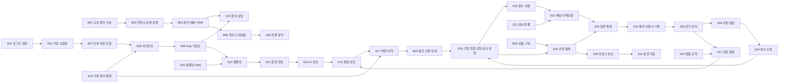

# ISOEdu 참고자료 기반 작성·구현 기준

검토일: 2026-10-14. 기준 원본은 `참고자료`의 「조영빈Iso 플랫폼 2차_20261012.pptx」(36장)와 「어니스톤 사업계획서 서티멘토서티루트 마스터본초안 20261010 v5.pdf」(18쪽)이다. 실제 파일명은 [기능 레지스트리](feature-registry.json)의 sources를 따른다.

## 자료의 역할

사업계획서 1~2·6~8쪽을 고객, 상품, 운영 범위의 기준으로 사용한다. PPTX는 화면 구조와 세부 기능의 기준이다. 기존 `functional_specification.md`와 `FUNCTIONAL_SPEC_SHEET.md`는 이전 명세로 유지하되, 충돌은 이 문서에 기록하고 최신 자료를 우선 적용한다. 사업계획서의 가격은 안, 매출·파트너 수익은 추정, 확인 필요 항목은 미확인으로 보존한다. 법령·표준 개정 날짜는 자료 속 주장으로만 취급하며 실제 서비스 정책에 적용할 때 공식 자료로 재확인한다.

## 사업 흐름과 기능 연결

화살표는 제안된 데이터·업무 인계이며, 모든 화면을 차례로 클릭해야 한다는 뜻이 아니다. 개별 장표의 선행 관계는 [장표 연결표](slide-feature-map.md)와 [레지스트리](feature-registry.json)에서 관리한다. S05는 기업 요약, S31은 운영 요약으로 각 기능의 저장된 결과를 집계한다.

## 연결을 보존할 데이터 계약

| 경계 | 다음 기능으로 전달할 데이터 | 확인 조건 |
| --- | --- | --- |
| 계정 → 모든 기능 | 사용자, 회사, 회사별 역할, 프로젝트 접근 범위 | 서버에서 회사·역할 검사; 가입 유형만으로 특권 부여 금지 |
| 기업 → 진단 | 회사·사업장, 업종, 규모, 인증 종류·판본·범위 | 사업장과 심사 범위를 구별 |
| 진단 → 문서 | 진단 ID, 조항 ID, 미충족 항목, 기준 버전 | 준비율 계산의 분모·미답변 처리 명시 |
| 문서 → 신청 | 문서 ID, 검토 상태, 고정된 버전·증적, 신청자 | 제출 당시 버전을 보존; 편집 후 제출본 변조 방지 |
| 문의 → 파트너 | 문의 ID, 동의, 전문분야, 배분 규칙 버전, 담당자 | 배분 근거·수락·거절·재배분 이력 |
| 신청 → 심사 | 신청 ID, 인증기관, 견적, 결제 상태, 심사원, 이해상충 검토 | 기업 직접 제출과 플랫폼 내부 요청을 구별 |
| 심사 → 사후관리 | 결과 ID, 발급기관, 인증서, 유효기간, 다음 심사일 | 공식 발급과 파일 업로드 구별; 날짜 누락은 미확인 |
| 결제 → 정산 | 주문 ID, 실제 결제액, 환불액, 계약·배분율 버전 | 정수 원 단위 또는 decimal 사용; 상태 변경은 서버 확정 |
| 일정 → 알림 | 회사·담당자, 동의·채널, 이벤트, 기준 시점 | 중복 방지·실패 재시도·발송 이력 |

## 디자인 분석과 적용

36개 장표의 삽입 화면 이미지를 추출해 [전체 디자인 비교 이미지](slide-design-contact-sheet.jpg)에서 검토했다. 원본 장표 자체는 제목·화면 이미지·기획 의도·기술 명세로 구성된다. 제목 24pt와 본문 회색(#333333/#555555)은 프레젠테이션 텍스트 값이며, 웹 디자인 토큰으로 그대로 옮기지 않는다.

화면 이미지의 반복 패턴은 밝은 회색 배경, 흰 작업 영역, 파란 주요 동작, 좌측 메뉴, 상단 회사·사용자·알림, 우측 도움말·상세 패널이다. 일부는 짙은 남색 메뉴이고 일부는 밝은 메뉴이므로 웹에서는 하나의 공통 셸로 통일하는 것을 제안한다. 인증 종류·회사·프로젝트 선택은 화면 이동 후에도 유지하고 URL이나 명시적인 컨텍스트로 연결한다.

| 패턴 | 관련 장표 | 구현 기준 |
| --- | --- | --- |
| 단계 입력 | 2·7·13·19 | 현재 단계·필수 필드·임시 저장·다음 행동 표시 |
| 목록과 상세 패널 | 10·12·17·21·32·33 | 선택 항목과 필터 보존; 좁은 화면은 상세 페이지나 시트 |
| KPI와 근거 목록 | 5·8·9·26·31·36 | 요약 클릭이 실제 필터된 근거 목록으로 연결 |
| 문서 작업 | 14·15·16·17 | 작성→검토→버전 확정 연결; AI 초안과 승인된 문서 구별 |
| 일정과 상태 | 22·23·28·29 | 추천·임시 예약·확정 구별; 서버 충돌 처리 |
| 알림과 설정 | 25·27·34 | 알림에서 대상 문서·인증·신청으로 이동 |

정확한 웹 폰트·간격·색상은 이미지 눈대중으로 확정하지 않는다. 실제 구현에서 토큰을 정의하고 대표 화면을 원본과 비교한다. 상태는 색상과 문자를 함께 사용하고, 주요 행동을 명확히 둔다. 모든 화면은 로딩·빈 상태·실패·권한 없음·저장 성공을 갖춘다.

## 원본 간 차이와 결정 기준

| 항목 | 자료 간 차이 | 작성 기준 |
| --- | --- | --- |
| 신청·발급 | PPT S19·S24는 신청·발급까지 기술; 사업계획서 6쪽은 기업 직접 신청 | 준비 자료·셀프 안내·기업 제출 기록을 기본으로. 공식 심사 접수·배정·발급은 인증기관 역할과 연동 범위 확정 후 구현 |
| 수입·취득 보장 | 기존 명세는 과태료·불이익 제로 보장과 대행 수수료 표현; 사업계획서 5~6쪽은 취득·일감 보장 및 성공보수 배제 | 제품 문구와 새 명세는 사업계획서 기준으로 작성 |
| 교육·파트너 | PPT에는 수강·수료·파트너 CRM 전체 흐름 부재 | B01~B06으로 별도 추적; 심사원 자격과 준비 컨설턴트 역할을 분리 |
| 상품·배분 | 사업계획서 6쪽 가격·70% 배분은 계획안 | 변경 가능한 상품·계약 버전으로 설계; 실제 확정 요율처럼 하드코딩하지 않음 |
| 외부 플랫폼 실적 | 사업계획서 7쪽의 서류다 v2.8 운영 언급 | ISOEdu에서 OCR·알림·결제가 구현됐다는 근거로 사용하지 않음 |
| 기술 스택 | PPT에 여러 상태관리·차트·API 예시 혼재 | 현재 Next.js·Supabase 구조를 우선 사용; 필요가 검증될 때 도입 |

## 구현 순서와 완료 기준

1. 계정·회사·역할과 인증 등록(S02~S04·S07)을 먼저 연결한다.
2. 자가진단·Gap·문서(S08~S17)를 하나의 회사·프로젝트 데이터로 연결한다.
3. 사후관리(S26~S29)와 셀프 안내(B04)를 연결한다. 자동 발송은 실제 발송 인프라 검증 후 표시한다.
4. 교육·파트너 검증·문의 배분(B01~B03)을 준비 상담(S10)에 연결한다.
5. 상품·결제·구독·정산(B05·S20·S35)을 확정된 계약으로 연결한다.
6. 기관 연동 심사 운영(S19·S21~S24·S33)과 운영 CMS·분석(S31~S36·B06)을 확장한다.

이는 개발 의존성 기준의 제안이며 사업계획서 8쪽의 2026~2027년 사업 일정과 구별한다. 현재 코드 후보 매핑은 정적 확인만 했으며 운영 완료 판정이 아니다.

각 작업은 관련 S/B ID, 원본 근거, 화면 변화, 입력·출력 데이터, 선행·후속 기능, 권한, 검증 결과를 기록한다. 레지스트리와 연결표를 함께 갱신한다. UI 버튼이나 목업만 있는 기능은 실제 연동 완료로 표시하지 않는다. 참고자료가 갱신되면 원본 날짜와 변경된 ID·연결·상품 정책을 먼저 기록한다.

## 공통 디자인 1차 적용 기록 (2026-10-14)

공통 토큰·Button 컴포넌트·ISOEdu 헤더·인증 관리 탐색을 구현했다. 관련 기능은 S02·S05·S08·S11·S19·S26이다. 로그인·문서 등록·배너 주요 동작에 공통 버튼을 적용했다. 기존 회사 컨텍스트와 저장·권한 경로를 사용하며 탐색만으로 데이터를 수정하지 않는다. `npm run build` 성공, `npm test` 30개 통과. 실제 브라우저 시각 검증 및 모든 화면의 입력·표 컴포넌트 통합은 남아 있다. 이 기록은 개별 업무 기능의 완료를 의미하지 않는다.

## 개발 스타일 로딩 복구 (2026-10-17)

개발 서버와 프로덕션 빌드가 `.next`를 함께 사용하면 실행 중인 페이지의 CSS 경로와 생성 파일이 불일치할 수 있다. `next.config.mjs`에서 개발 출력은 `.next-dev`, 빌드는 `.next`로 분리했다. `.next-dev`는 Git 제외 대상으로 추가했다. localhost:3000 새로고침 후 남색 메뉴·도넛·카드 스타일 렌더링을 확인했다. 업무 데이터·권한 변경 없음.

## 플랫폼 브랜드

사용자 확정 명칭은 **어니스톤**이다. 로고·페이지 제목·로그인·도움말의 플랫폼 표기를 통일한다. ISO는 인증 분야 명칭으로 사용한다. 기존 isoedu 저장소·로컬 저장 키·기업 자료 원문은 유지한다.

어니스톤 파비콘: `src/app/icon.svg`. 남색 바탕·파란 돌 형태·흰색 H로 구성하며 Next.js 아이콘 메타데이터로 제공한다.

## 고객 작성사례의 서비스 연결

2026-10-18: /documents/references에서 작성사례123개·65묶음 목록/고객/형식 검색 및 뷰어 연결. PDF는 Range 지원 원본 뷰어, HWP/HWPX/DOC/DOCX/PPT/PPTX는 전 구간 추출 본문과 원본 다운로드 제공. 각 문서 원문 목차 후보 또는 유형별 제안 구성은 사용자 검토 후 대상 회사·사업 아이템에 적용한다. 타 회사 원문 수치/실적 복사 없이 목차별 입력 초안을 미리보고 기존 문서 저장소에 DRAFT로 저장한다. companyId, businessItem, referenceOrigin(id/sha256/revision/headings/확인상태)을 S03→S12/S13→S14/S15→S17에 인계. 파일은 localhost 개발서버에만 제공하며 운영환경 API403, 현재회사 문서 저장은 기존 인증/RLS 경로 사용. 로컬 저장소 재조회·회사 격리·클라우드 필드 변환 테스트 검증. 실제 로그인한 회사의 클라우드 저장은 미검증. AI 본문 완성 및 원본 편집형식 내보내기는 미구현.

## 거래처별 실제 문서 관리

2026-10-18 사용자 정정 반영: 참고문서 라이브러리를 문서 관리 기본 화면에서 제외하고 /documents 거래처 드라이브로 대체. 원본 라벨 기준65개 거래처 폴더에 기존123개 문서를 연결했다. /documents/iso는 기존 ISO 규격 문서, /documents/references?reference=...는 기존 링크 호환용 거래처 파일 뷰어 진입. 거래처/하위 폴더 생성, 파일 업로드(50MB), 이름 변경, 폴더 이동, 휴지통/복원, 원본 다운로드·PDF/이미지/추출 본문 뷰어, TXT/MD 편집과 이전 바이트 보관 구현. 다른 거래처 문서 작성은 대상 폴더의 거래처ID·이름과 사업 아이템을 사용해 목차 기준 MD 초안을 실제 파일로 생성하고 referenceOrigin/작성 상태를 보관한다. S03 거래처→S11 파일→S12 기준→S13 입력→S14/S15 작성/편집→S17 근거·이력 인계. 현재 데이터는 data/client-drive/state.json 및 로컬 파일에 저장하며 로컬 단일 사용자 범위다. Supabase 회사/사용자 권한·공유/동기화와 연동 완료한 것으로 표시하지 않는다. 법인 관계나 현재 계약 여부는 원본 폴더명만으로 확정하지 않는다.

50개 테스트 통과 및 빌드 성공. 직렬화된 저장·재시작 재조회·동시 변경 보존·폴더 순환/중복 차단·원본 보호·휴지통 접근404·복원·대상거래처 초안 생성·텍스트 편집 이전본 보존 검증. 실제 로컬API에서도 업로드/이름변경/이동/편집/다운로드/휴지통/복원/초안 생성 확인. 임시 항목 정리 후65폴더123파일 유지. 외부 클라우드 저장·공유·전체Office 원본배치 뷰어는 미구현.

## 최근 회의의 우선순위 (2026-10-29 사용자 지시)

[2026-10-23 회의 반영 명세](meeting-2026-10-23.md)를 최신 업무 우선순위로 적용한다. CRM 이관, 회사별 공동 컨설턴트, 고객 서류 제출, 실제 기관 양식 작성, 심사·만기 관리 순이다. 기존 개발 의존성·기업 직접 신청과 공식 기관 역할 구분은 유지한다. 관련 B03·S02·S03·S11~S13·S15·S17·S20·S23·S24·S26·S27·S33의 인계와 검증 상태를 레지스트리·연결표에 함께 기록했다. 코드·로컬 DB 검증과 실제 운영 적용을 구분한다.

## 유형별 원본 유효기간과 최신본 재요청 (2026-10-29)

S03 → S13 → S11 → S17 → S26/S27·S33: 노션 유형별 기준을 버전 보관하며 신청일·설립일·원본 발급일/유효일·자료 연도·기간 확인과 회사/프로젝트/문서 ID 및 원본 경로/해시를 인계한다. 2주·달력 1개월·명시 만료·3개년을 구분하고 기준 없는 기간은 추측하지 않는다. 보유본 우선 수령 후 신청 창구에 맞춰 갱신 요청하며, 만료 제출본은 내부 보완 요청/업무로 전환한다. 동일 원본 반복 요청 방지, 새 파일 날짜 초기화, 접수 후 중지, 회사 권한·동시 저장 검증. 115개 테스트와 빌드 통과. 운영 DB 59개 규칙 적용·대표 권한 임시 생성/저장 후 롤백 검증 완료. 회사69·문서130 보존. pg_cron GMT 00:00(한국09:00) 예약 활성·최초 실행 오류0/활성프로젝트0. 프로젝트별 유형 기준 저장 후 자동 검사 대상이 된다. 외부 메시지는 발송하지 않는다.

## 업로드 원본의 날짜 후보 자동 읽기 (2026-10-29)

S11 → S16 자동 읽기 → S13 담당자 확인 → S17 날짜 저장 → S26/S27 재검사。고객 제출·심사 운영에서 업로드/보관 문서 제출 직후 PDF·스캔 이미지·HWP/HWPX·DOCX·XLSX의 날짜/자료 연도 후보를 브라우저에서 읽는다. 자체 제공 OCR, 외부 AI 전송 없음. 근거 위치·문구와 후보를 대조 확인한 후 기존 날짜 저장 RPC로 확정. 경로/revision 변경 시 폐기, 회사 전환 중단, 실패해도 원본 보존. 후보는 임시 화면 상태이며 다시 읽기 가능.

50MB·PDF 앞60쪽. HWP/Office 삽입 이미지/도형·비표준 Excel 서식 미확인 경고. 구형 DOC/XLS 자동 판독 미지원. 일반 드라이브 전체 업로드 소급 분석은 별도 범위. 121개 테스트·빌드 통과. 브라우저 합성 한국어 스캔/스캔PDF/HWP/HWPX/DOCX/XLSX 및 Excel 날짜일련번호 판독. 확인 전 저장 차단·값 수정 후 재확인 검증. 기존 DB 권한/저장 함수 사용, 스키마 변경 없음.

## 기존 거래처 문서 날짜 확인함 (2026-10-29)

S11 기존 거래처 문서 → S16 본문/OCR 후보 → S13 원문 대조 확인 → S17 날짜 사실·확인 이력。거래처 드라이브의 전체/회사별 날짜 확인 목록. 원본 해시를 대조하고 기존 추출 본문을 우선 활용, 없는 자료는 본문/OCR. 확인 대기/후보 없음/실패/완료 저장, 실패 재시도·이어 처리·중지. 회사 편집 권한과 원본 경로/행 변경 시점 확인. 원본 변경 시 기존 후보 무효화. 일반 문서 편집에서 후보 유실·위조 차단.

documents.metadata.dateReading은 미확정 후보/근거, dateFacts는 담당자 확인값. 공식 인증 expiry_date·심사/프로젝트 유효기간 상태를 자동 변경하지 않음. 기존 내부 요청의 날짜 인계는 별도 승인 흐름을 유지. 127개 테스트와 빌드 통과. 운영 저장 RPC·보호 트리거 적용, 대표 계정 접근 가능 기존 문서의 실제 일괄 분석 진행. 사용자 확인/외부 발송은 수행하지 않음.

운영 실제 실행 결과: 대표 계정126건(후보26·후보없음100·실패0·사용자확인0). 원본 미이관3건은 저장본문 후보와 원본 미확인 경고로 구분, 50MB 초과 원본 저장 문제는 미해결. 확인 목록20건씩 페이지·근거 펼칠 때만 표시, 후보/없음/원본미확인 필터와 /documents?dateReview=1 직접 진입. 원본/본문/인증 만료일 유지. 공동컨설턴트 관계 추가로 생긴 PostgREST 프로필 관계 모호성은 소속회사 FK 명시로 수정·실제 로그인 재조회 검증. 전체128개 테스트·빌드 검증.

## 문서 날짜 검토 화면 정리 (2026-10-29)

S11·S13·S16·S17: 기존 문서 목록을 날짜 후보·자료 연도·상태의 한 줄 표로 표시한다. 문서를 선택하면 전체 화면 원문과 우측 날짜 검토 양식을 함께 제공한다. 검색·상태 필터·페이지 이동, 이전/다음 문서 및 확인 저장 후 다음 이동을 제공한다. 참고사항·근거는 접어서 표시하며, 검토 전용 진입에서는 상단 제목·탭·도구 여백을 줄인다. 문서 ID와 updated_at별 임시 입력을 닫기·이동 후 유지하고 회사 전환 시 초기화한다. 기존 회사 권한·원본 경로/버전·확인 RPC와 S16→S13→S17 전달을 유지한다. 실제 날짜 확정값·인증 만료일을 자동 변경하지 않는다. 로컬 목록·검토 패널·이전/다음·임시 입력·Esc를 확인했으며 실제 문서 확인 저장은 하지 않았다. PDF는 브라우저의 열기 설정에 따라 추가 열기가 필요할 수 있다.

## PDF 원문 즉시 표시 (2026-10-29)

S11·S16·S17: 공통 CloudFileViewer에서 PDF 원본 및 DOCX/HWP 등의 PDF 변환 미리보기를 브라우저 PDF 플러그인 대신 PDF.js 캔버스로 직접 표시한다. 문서를 선택하면 첫 페이지를 즉시 불러오고, 인접 페이지는 스크롤 시 렌더링하며 폭에 맞춘다. 기존 인증된 파일 URL·원본 다운로드·추출 본문·S13 날짜 검토를 유지한다. 로컬 실제 DOCX 변환 PDF가 별도 열기 없이 표시됨을 시각 확인했다. 앞선 검토 UI 문단의 브라우저 PDF 열기 설정 제한은 이 직접 렌더링으로 해소한다.

## PDF 읽기 도구 (2026-10-29)

S11·S16·S17: PDF 원본/변환 미리보기 공통 도구줄에 확대·축소(25~300%)·너비 맞춤, 페이지 번호 입력 및 이전/다음 페이지 이동, 원문 TextLayer 드래그 선택·복사, 문서 전체 검색(Cmd/Ctrl+F)·결과 수·이전/다음 결과·본문 강조를 제공한다. 검색은 문서 메모리에서 처리하고 파일·권한·S13 날짜 후보·S17 확인 저장을 변경하지 않는다. 스캔 등 텍스트가 없는 페이지는 OCR 필요 안내를 제공하며 OCR 자동 수행은 포함하지 않는다. 검색어 변경/종료 시 오래된 검색 작업을 취소하고 인접 페이지만 렌더링한다. 로컬 실제 9쪽 DOCX 변환 PDF에서 3쪽 이동·198% 확대·본문 범위선택·검색10건·마지막 결과9쪽 이동을 확인했다. 검색 분절/공백·호환 문자·강조 원문 보존 테스트 포함131건 통과.

## 스캔 PDF 자동 OCR (2026-10-29)

S11·S16·S17: 텍스트가 없거나 글자가 적은 이미지 페이지를 한국어·영어 OCR로 자동 읽고, 좌표 기반 선택 레이어와 문서 검색 결과에 통합한다. 전체 페이지를 자동 순회하며 한 문서의 OCR은 순차 처리한다. 완료 페이지부터 선택·복사·검색·강조를 제공하고, 진행·빈 페이지·실패·재시도를 구별한다. 페이지 제한을 두고 전체 완료로 표현하지 않으며, 실패는 명시한다. 모델·worker는 자체 제공하며 문서 픽셀은 브라우저에서 처리한다. 문서를 닫으면 worker·렌더링·인식을 중지하며 결과는 현재 열람 세션에만 캐시한다. 기존 원본·metadata·회사 권한·S13 날짜 후보/확정값·S17 저장은 변경하지 않는다. OCR 오인식 가능성을 표시하며 앞선 PDF 도구의 스캔 선택/검색 제한을 이 자동OCR로 보완한다. 텍스트가 전혀 없는 한/영 2쪽 시험PDF에서 OCR·검색(Alpha2건/사업계획서1건)·결과 페이지 이동·좌표 강조·드래그 선택을 시각 확인했다. 테스트135건 통과, 시험 route와 파일은 제거한다.

## 기업회원 즉시 사용 화면 (2026-10-29)

S01·S02·S03·S05·S11·S13·S16·S17: 신규 기업은 별도 가입 승인 없이 기존 가입 트리거로 생성되는 자기 회사 공간에 바로 진입한다. 기업 화면은 ‘우리 회사 준비/진행 현황/회사 문서함/회사·계정’으로 구성하고 처음에는 보유 서류 저장을 안내한다. 컨설턴트 거래처 관리·내부 운영 설정과 분리하되 공식 인증 심사/발급 역할을 부여하지 않는다. my_company_connections 조회 함수는 활성 본인의 can_read_company 회사와 can_edit_company 결과만 반환하고 UI 구분은 실제 관리 연결/공동 담당·관리자 역할에 따른다. 가입 metadata나 회사명 일치로 기존 거래처에 자동 연결하지 않는다. 기존 회사 가입 요청/권한 회수는 기존 계약대로 유지한다. 회사·계정별 화면 상태 격리와 사이드바 접기/펼치기(UX-001)를 유지한다. 회사 원본 업로드는 문서 생성→원본/버전 저장→문서 연결을 수행하며 동일 내용 재시도 시 버전을 재사용하고 계정/회사 전환 시 후속 쓰기를 중단한다. S13 제출·S17 저장에 회사/프로젝트/문서 ID를 전달한다.

검증: 테스트140건(서버 권한·즉시 자기회사 생성·동일 이름/metadata 위조 격리·기존 가입 승인과 회수·비활성/익명·업로드 재시도/전환) 통과. 합성 기업으로 첫 화면·회사 문서함·사이드바 접기 유지 시각 확인. 운영 인증 서버는 가입 허용 및 이메일 자동확인 상태를 읽기 검증했다. 실제 신규 회원 생성·운영 파일 업로드 시험은 하지 않았으며 시험 route는 배포에서 제거한다.

운영 확인: 사용자 승인 후 조회 함수 적용 성공을 확인했고 기존 CEO 로그인은 컨설턴트 내 업무·거래처 드라이브를 유지했다. 신규 기업용 첫 화면은 별도 가입 승인을 추가하지 않는다.

## 공개 랜딩과 준비 업무 연결 (2026-10-29)
S02·S03·S05·S11·S16: 공개 /는 기업용 간단 시작 화면이다. /dashboard는 기존 업무 공간으로 유지한다. neonpeter.com의 큰 제목·단순 진입 구성만 참고하고 어니스톤은 아이보리·딥그린 색상을 사용한다.
관심 분야 → 회사명·업종·직원 수·선택 소재지 → 기본 준비 안내 → 가입/로그인 → 대상 회사 확인 → 기존 work_tasks 저장으로 연결한다. 준비 안내는 신청 자격·심사 적합성 판정이 아니다. 회사명은 가입 입력에 전달하되 기존 회사 접근 권한을 부여하지 않는다.
게스트 정보는 해당 탭 sessionStorage에 임시 보관한다. 로그인 후 사용자에 귀속하고 로그아웃·계정 변경 시 지운다. 저장은 접근 가능한 편집 회사 중 사용자가 확인한 회사로만 수행하며 서버 RLS를 유지한다. 입력 ID로 중복 재시도를 구분하고 실패 시 입력을 유지한다. 공식 마감은 추측하지 않는다. B03 상담 접수·담당 배분은 연동되지 않는다.
검증: 143개 테스트와 빌드 통과. 게스트 준비 안내 및 가입 회사명 전달, 데스크톱/390px 화면 확인. 운영 신규 가입·실제 업무 생성은 실행하지 않았다. 공개 배포 후 홈 응답 확인 예정.

디자인 보완: S02·S03·S05 공개 진입에 자체 SVG 입체 H, 딥그린·크림 히어로, 분야별 기하 그래픽, 정보→문서→업무 연결 그래픽을 적용했다. 390px/데스크톱 시각 검수 및 빌드 통과. 동작·데이터·권한 계약은 유지하며 모션 감소 설정을 존중한다.

하단 전체 디자인 보완: S02·S03·S05·S11·S16의 소개를 문서/업무/회사 공간 비대칭 그래픽 카드로 표현하고 간편 시작·이용 단계·마지막 CTA·푸터까지 딥그린/세이지/크림 시각 언어를 연결했다. 그래픽은 기능 소개/화면 예시로 표시하며 실제 신청·인증 결과를 만들지 않는다. 데스크톱·390px 시각 검수, 분야 선택→회사 정보 이동 및 빌드 확인. 데이터·권한·저장 동작 변경 없음.

랜딩 모션 보완: S02·S03·S05 공개 소개 영역에 1회 스크롤 등장·카드 순차 전환·장식 그래픽의 작은 스크롤 이동/부유/호버 반응을 적용한다. useLandingMotion은 기본 내용을 숨기지 않는 점진적 향상이며 키보드 포커스 시 전환을 완료한다. 움직임 감소 설정 변경 시 실행 애니메이션을 취소하고 정적으로 표시한다. 관찰자·리스너·요청 프레임은 정리한다. 스크롤 후 내용/그림 표시·브라우저 오류 없음·빌드 확인. 데이터와 권한 계약 변경 없음.

모바일 모션 보완: S02·S03·S05 공개 랜딩은 700px 이하/coarse touch에서 340ms·10px 이동·순차 지연 없음으로 조정한다. 초기 보이는 내용은 애니메이션을 생략하고 화면 하단 96px 선행 감지, 빠른 스크롤 중 전환 완료/생략으로 내용 우선 표시한다. 반복 부유/필터 효과와 스크롤 parallax를 모바일에서 끄며 입력 폼은 등장 전환 대상에서 제외한다. 입력 16px 및 제목 줄바꿈 조정. 375px·390px 브라우저에서 입력값 유지, 가로 넘침 없음, 폼 정적 표시와 모바일 장식 animation/translate none 확인. 실제 휴대폰 FPS/저사양 CPU 측정은 미실행. 빌드 통과. 저장·권한 계약 유지.

## 공개 지원사업 캘린더와 가입 퍼널 (2026-10-30)
G01 → S02 → S03 → S05/S13 → S11/S16: 홈의 첫 CTA를 지원사업 일정 보기로 바꾸고 실제 저장된 공고 미리보기를 기업인증/ISO 소개 앞에 배치한다. /programs는 로그인 없이 달력·목록·검색·분류·공고 상세·제출서류·원문 첨부 링크를 열람하는 공개 경로다. 기존 /government-programs 내부 업무 경로는 유지한다.
월/보기/검색/분류/날짜/선택 공고/페이지는 URL로 유지한다. 날짜 미확인 사업을 임의로 달력에 넣지 않으며 수집 범위와 시각, 부분 분석·미해결을 표시한다. 공개 API는 기존 정부 공고 저장본만 제공하며 회사 문서나 사용자 업무를 반환하지 않는다. 이번 기능은 원본 수집 데이터 수정이나 실시간 외부 수집을 수행하지 않는다.
관심사업 저장/신청 준비를 선택하면 공고 ID·원문·확인시각·참고 마감·제출서류 이름·의도·인계 UUID를 탭 세션에 보관한다. 로그인 후 편집 가능한 대상 회사를 확인하고 기존 work_tasks에 저장한다. 마감일은 참고로 보관하며 공식 업무 마감일로 자동 확정하지 않는다. 공식 신청·자격 판정·자동 컨설턴트 배분은 수행하지 않는다. 취소/실패 시 선택을 유지하고 중복 재시도를 처리하며 로그아웃/계정 전환의 기존 임시정보 격리를 따른다.
검증: 148개 테스트 통과, 공개 API200, 비로그인 상세/서류/원문 링크, 관심사업→가입, 취소 후 선택 유지, Esc 닫기, URL 검색/보기 상태, 모바일390px 날짜 선택/목록 확인. 실제 신규 계정 생성·운영 업무 저장은 미실행. 빌드와 운영 배포 후 공개 진입을 별도 확인한다.

공개 수집본 동기화: 기존 2026-10-29 정리본 공고87건·분석55건의 ID/원문 호스트를 확인해 배포한다. 신규 수집·분석 완료를 주장하지 않는다. 공개 응답은 공고/분석 요약 필드를 명시해 반환하고 회사별 인계·로컬 증거 경로·내부 큐 정보는 제외한다. 관련 격리 테스트 포함148개 통과.
